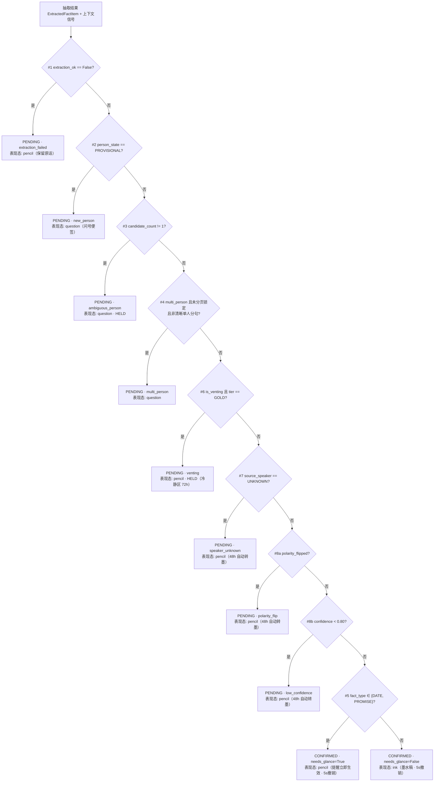

# MindWeave（心络）AI 多模型接入架构、核心业务规则与演示切换手册

> **文档版本**：`v1.2`（2026-11-23 · Demo Day Ready）  
> **适用范围**：AI Model Gateway（`src/mindweave/ai/`）、Prompt 资产库（`prompts/`）、核心配置（`src/mindweave/core/config.py`）、服务端 8 道写入门禁（`GatePolicy`）与双层安全通道（`SafetyService`）。  
> **关联契约**：`ADR-001`、`ADR-005`、`ADR-007`、`ADR-011`、`ADR-013`、`P0_FRONTEND_CONTRACT.md`。  
> **评测基线**：离线全量评测 `66/66 (100.0%)`（跨人串扰 `0.00%` · 虚构引用 `0.00%` · 归档准确率 `100.00%` · 危机召回 `100.00%` · 夸张口头禅误报 `0.00%` · 银箭越界泄漏 `0.00%`）。

---

## 一、多模型提供方接入与任务级路由矩阵

MindWeave 的所有外部模型调用统一收口于六边形网关 `ModelGateway`（`src/mindweave/ai/gateway.py`），业务层仅面向 `ModelGatewayPort` 编程，通过 `.importlinter` 在 CI 层强制保证 `google.genai` 等厂商 SDK 绝不泄漏至 `ai/adapters/` 之外。

### 1.1 五大提供方接入协议与多模态能力

| Provider 标识 | 适用场景 | 底层适配器 | 文本/JSON 结构化 | 聊天截图视觉（`image/*`） | 真实音频直入（`audio/*`） | M6 境内生产（`prod_cn`） |
| :--- | :--- | :--- | :---: | :---: | :---: | :---: |
| **`gemini`** | 研发自测 / 国际演示首选（原生多模态延迟极低） | `GeminiAdapter`（`google.genai`） | 原生 `response_schema` | `types.Part.from_bytes` | 原生 `types.Part.from_bytes`（自动剥离 `;codecs=...` 并归一 `m4a→mp4`、`mp3→mpeg`） | **严格禁止** |
| **`dashscope`** | 阿里云百炼 · 境内生产全栈主力（推荐） | `OpenAICompatibleAdapter`（`httpx`） | `response_format=json_object` + Schema System Prompt | `image_url` Base64 Data URI（`qwen-vl-max`） | `input_audio` 多模态块（`qwen-audio-turbo` / `qwen-omni-turbo` / `qwen2.5-omni-7b`） | **允许（主力）** |
| **`ark`** | 火山方舟（豆包）· 境内生产备选/主力 | `OpenAICompatibleAdapter`（`httpx`） | `response_format=json_object` + Schema System Prompt | `image_url` Base64 Data URI | `input_audio` 多模态块（需多模态接入点或配合独立 ASR） | **允许** |
| **`deepseek`** | DeepSeek-V3 · 高性价比文本抽取与伴聊 | `OpenAICompatibleAdapter`（`httpx`） | `response_format=json_object` + Schema System Prompt | 建议配合 `dashscope` | **建议配置 `MINDWEAVE_AI_ASR_PROVIDER=dashscope`** | **允许** |
| **`fake`** | 离线 CI / 66 例评测 / 断网演练保底 | `FakeAdapter` | 确定性规则引擎 | XML/气泡文本解析 | 语境纠错 + 静音空串零幻觉 | **严格禁止** |

#### 多模态音频 Wire Protocol（`OpenAICompatibleAdapter`）

浏览器 `MediaRecorder` 与移动端上传的音频（含 `;codecs=opus` 等参数后缀）经统一 MIME 规范化后，封装为标准 OpenAI 兼容多模态消息体，彻底消除旧版仅接受 `image/*` 导致的语音速记崩溃：

```json
{
  "role": "user",
  "content": [
    {
      "type": "input_audio",
      "input_audio": {
        "data": "<base64_encoded_audio>",
        "format": "webm"
      }
    },
    {
      "type": "text",
      "text": "<rendered transcribe_audio@1.1.0 prompt>"
    }
  ]
}
```

支持的音频 MIME 映射表：
- `audio/webm`（含 `audio/webm;codecs=opus`）→ `webm`
- `audio/mp4` / `audio/m4a` / `audio/x-m4a` → `mp4`
- `audio/mpeg` / `audio/mp3` → `mp3`
- `audio/wav` / `audio/x-wav` / `audio/wave` → `wav`
- `audio/ogg` / `audio/opus` → `ogg`

### 1.2 任务级路由矩阵与独立 ASR 通道

`src/mindweave/ai/routing.yaml` 定义声明式任务参数，`ModelGateway._provider_chain_for_task(task)` 与 `_resolve_model(task, provider)` 负责按任务分流：

| 任务 `task` | Prompt ID & 版本 | 温度 | 默认超时 | `gemini` 模型 | `dashscope` 模型 | `ark` 模型 | `deepseek` 模型 | 独立路由覆盖 |
| :--- | :--- | :---: | :---: | :--- | :--- | :--- | :--- | :--- |
| **`transcribe`** | `transcribe_audio@1.1.0` | `0.0` | `18.0s` | `gemini-2.5-flash` | **`qwen-audio-turbo`**（`dashscope_asr_model`） | `doubao-1-5-pro-32k` | `deepseek-chat` | **`MINDWEAVE_AI_ASR_PROVIDER`**（非 `inherit` 时置顶） |
| **`parse_screenshot`** | `parse_screenshot@1.0.0` | `0.1` | `18.0s` | `gemini-2.5-flash` | **`qwen-vl-max`**（`dashscope_vision_model`） | `doubao-1-5-pro-32k` | `deepseek-chat` | 遵循主备链 |
| **`extract_record`** | `extract_record@1.2.0` | `0.1` | `18.0s` | `gemini-2.5-flash` | `qwen-plus`（`dashscope_extract_model`） | `doubao-1-5-pro-32k` | `deepseek-chat` | 遵循主备链 |
| **`ask_relationship`** | `ask_relationship@1.3.0` | `0.3` | `18.0s` | `gemini-2.5-flash`（`gemini_model_chat`） | `qwen-plus` | `doubao-1-5-pro-32k` | `deepseek-chat` | 遵循主备链（支持 SSE 流式） |
| **`safety_classify`** | `safety_classify@1.0.0` | `0.0` | **`5.0s`** | `gemini-2.5-flash` | `qwen-plus` | `doubao-1-5-pro-32k` | `deepseek-chat` | 独立短超时，超时 fail-safe 退回 L1 |
| **`summarize_thread`** | `summarize_thread@1.0.0` | `0.2` | `12.0s` | `gemini-2.5-flash` | `qwen-plus` | `doubao-1-5-pro-32k` | `deepseek-chat` | 异步后台压缩滚动摘要 |

### 1.3 架构级合规与韧性红线（全任务统一生效）

1. **M6 境内生产合规双层硬闸门**：当 `MINDWEAVE_ENVIRONMENT=prod_cn` 时：
   - **启动期拦截**（`Settings._validate_production_guardrails`）：`ai_primary_provider`、`ai_fallback_provider`、**`ai_asr_provider`** 任一项为 `gemini` 或 `fake`，进程立即抛出 `ValueError` 拒绝启动；同时校验必须替换开发态 `kek_hex` 与 `jwt_secret`、关闭 dev OTP 回显与 log-only 推送。
   - **运行期拦截**（`ModelGateway._assert_provider_allowed`）：在路由链解析与适配器调用前二次校验，防止任何动态配置或 `routing.yaml` 越权回落至跨境模型。
2. **ADR-001 推理模型禁令**：配置校验器与 `validate_non_reasoning_model()` 强制拦截 `deepseek-reasoner` / `*-r1` 型号，保障丘比特伴聊首字响应延迟（TTFT）达标。
3. **前置硬 PII 掩码（PIA 护盾 3）**：在文本送往任何外部模型前，统一经 `mask_hard_pii` 确定性脱敏 18 位身份证号（含 ISO 7064 校验）、银行卡号与明文密码——覆盖用户输入、语音上下文片段 `recent_context_snippets`、`KnownPersonRef.recent_facts`、`recent_history_hints`、已确认事实与历史对话轮次，同时保留人物昵称与日期。
4. **严禁语义缓存（Invariant I9）**：`routing.yaml` 中 `semantic_cache_enabled` 恒为 `false`，若误改为 `true` 加载期直接抛异常，彻底杜绝跨人/跨用户记忆串扰。
5. **零正文计量（Invariant I10）**：`AiCallMeter` 仅向 `ai_calls` 写入 `task`、`provider`、`model`、`prompt_id`、`prompt_version`、`prompt_hash`、Token 数、延迟、微元估算成本与状态码，**绝不落库任何提示词或回复正文**。
6. **高可用容灾链**：瞬态故障（408/429/5xx/超时）指数退避重试 3 次 → 每提供方独立熔断器（连续失败 3 次打开 30s，到期进入 `half_open` 探活）→ 自动降级切换 `ai_fallback_provider` → 结构化 JSON 校验失败自动 1-Shot Repair 重试 → 全部失败仍按铁律 I2 将原始输入降级存为 `note` 铅笔稿，**用户输入 0% 丢失**。

---

## 二、结合历史消息与人物词表的 ASR 纠错与口误自修正规则

语音速记（`POST /v1/voice/ingest`）是心络最高频的零摩擦入口。针对中文口语中常见的“同音专名误识”“说话到一半改口”“静音误触发幻觉”，系统采用 **Prompt 语境注入 + 确定性后处理兜底** 双重机制。

### 2.1 上下文注入契约（`TranscribeInput` → `transcribe_audio@1.1.0`）

| 字段 | 类型 | 注入标签 | 作用 |
| :--- | :--- | :--- | :--- |
| `audio_bytes` / `mime_type` | `bytes` / `str` | 原生音频输入 | 支持 `webm` / `mp4` / `m4a` / `mp3` / `wav` / `ogg` |
| `active_person_name` | `str \| None` | `<active_person>` | 当前停留的人物分页名称（分页内语音速记最高权重） |
| `known_person_names` | `list[str]` | `<known_person_names>` | 用户手帐全部已建档人物称呼与别名词表 |
| `recent_context_snippets` | `list[str]` | `<recent_context>` | 用户近期手帐高频话题、偏好、健康/工作关键词片段（已过硬 PII 掩码） |

### 2.2 `transcribe_audio@1.1.0` 四条零容忍铁律

1. **原音忠实保真（`raw_transcript`）**：逐字保留说话人真实语音内容（含口误前的原话），严禁润色、扩写或删除事实。
2. **仅凭词表与近期语境修正同音错字（`corrected_transcript`）**：
   - 仅当存在明显中文平翘舌、前后鼻音或同音字误识，且被 `<active_person>`、`<known_person_names>` 或 `<recent_context>` 确切印证时修正：
     - 人物称呼：`程经理` → `陈经理`、`林雨` → `林屿`、`苏糖` → `苏棠`、`阿源` → `阿远`
     - 历史语境词汇：`桂花乌笼` → `桂花乌龙`、`纯羊容围巾` → `纯羊绒围巾`、`右西盖` → `右膝盖`
   - 严禁强行塞入未提及的人物，严禁改动用户真实表达的日期、数字与否定极性。
3. **句中口误自修正平滑处理（Self-Correction）**：
   - 识别口语更正标志词（`不对，是...`、`说错了是...`、`搞错了是...`、`口误...`），`raw_transcript` 保留完整原话，`corrected_transcript` 清理被撤回的口误片段：
     - `约了周五，不对，是周六` → `约了周六`
     - `和妈妈约了下周三复查，不对，是下周六` → `和妈妈约了下周六复查`
     - `刚跟阿哲，说错了是阿远，吃晚饭` → `刚跟阿远吃晚饭`
     - `买了茉莉花茶，说错了是桂花乌龙` → `买了桂花乌龙`
4. **静音/底噪/无法辨识零幻觉红线**：遇到静音、纯环境底噪或无有效人声，必须返回 `{"raw_transcript": "", "corrected_transcript": "", "duration_ms": null}`，严禁输出“你好”“谢谢观看”等常见 ASR 幻觉文本。

### 2.3 确定性后处理兜底管线（`asr_postprocess.py`）

`ModelGateway.transcribe()` 在拿到任意厂商（Gemini / 百炼 / Fake）的 `TranscribeOutput` 后，均会执行幂等纯函数 `postprocess_asr_transcript()` 作为确定性安全网：

- **同音词表恢复（`restore_context_homophones`）**：基于普通话/方言易混同音等价簇，仅在“长度一致 + 仅 1 字不同 + 至少 1 字精确匹配 + 差异字属于同音簇”时替换；若被识别词本身已是另一位已知人物真名（如同时建档了“陈经理”和“程经理”），或差异字属于数字/日期/否定词/代词/助词，**绝不误改**。
- **口误自修正（`resolve_spoken_self_corrections`）**：覆盖星期、日期、时刻、已知人物名与动词后等长名词短语五类场景；内置评价性前缀守卫（如“我觉得这样不对，是要跟她聊聊”），确保正常表达零误伤。

---

## 三、多人物 + 多事件零串话拆分归档规则与 8 道门禁

### 3.1 `extract_record@1.2.0` 抽取与消歧四重铁律

1. **人物分页硬锁定（`route_mode == "current"` 或 `scoped_person_id != null`）**：
   - 无主语或代词（她/他/TA）分句 100% 锁定当前分页人物（`scoped_person_locked: true`），严禁被“咖啡/早会/打球”等普通词跨人劫持。
   - 仅当某分句显式点名另一位已知人物时，才将该分句路由至被点名人物并由服务端门禁拦截确认。
2. **历史上下文隐式指代消解（`KnownPersonRef.recent_facts` & `recent_history_hints`）**：
   - 每位已知人物最多携带 6 条精炼近况事实（如 `妈妈.recent_facts = ["右膝盖疼，天冷要护膝"]`）。
   - 全局语音未点名但隐式提及历史事件（如 `上次说右膝盖疼那个复查改到下周六了`）：
     - **唯一命中 1 位人物**：直接绑定该 `person_id`，`needs_disambiguation: false`。
     - **同时命中 ≥ 2 位人物**（例如妈妈和爸爸近期记录均提到膝盖疼）：绝不瞎猜！强制设 `needs_disambiguation: true`、`matched_person_id: null`、回传全部 `candidate_person_ids`，对应事实 `person_id: null`，落入“问号便签”由用户点选。
3. **多人物零串话 + 同人物多事件 `event_group` 原子拆分**：
   - **跨人物零串话**：一句速记同时提到多人（如“林屿喜欢桂花乌龙，妈妈下周六复查右膝盖，陈经理周五前要合同签字”），必须拆分为归属各自 `person_id` 的独立 `facts[]`，且**每条 `content` 严禁残留其他人物的半句或称呼**。
   - **同人物多事件拆卡（`event_group`）**：当一句话针对**同一位人物**包含 2 个及以上互不相关的独立事件（如“妈妈农历腊月初八过生日，另外她下周六要去医院复查右膝盖”），为每个独立事件标注不同的 `event_group`（`"evt_1"`、`"evt_2"`），使服务端按 `(person_id, event_group)` 拆出多张独立清爽的手帐纸条；单一事件保持 `event_group: null` 完全向后兼容。
4. **UUID 零幻觉后校验（`ModelGateway._sanitize_extract_output`）**：
   - 抽取返回后立即核验 `persons[].matched_person_id`、`persons[].candidate_person_ids` 与 `facts[].person_id` 是否全部属于 `payload.known_persons` 真实集合；任何模型编造的非法 UUID 立即剥离为 `null` 并在非分页锁定时强制置 `needs_disambiguation = True`。
5. **多源专项防污染规则（保持 100% 兼容）**：
   - **聊天截图左右气泡铁律**：左气泡（`target_person`）提取对方偏好/忌口/心愿/日期/事件；右气泡（`user_self`）**仅允许提取用户对对方许下的行动承诺 `promise`**，用户自己的过敏/忌口 100% 剔除；群聊锁定分页时过滤其他群成员发言。
   - **日期与农历**：相对日期结合 `current_date` 换算为 `YYYY-MM-DD`；农历日期置 `is_lunar: true` 并抽取整数 `lunar_month` / `lunar_day`。
   - **反讽与气话穿透**：高浓度反话不抽正向偏好；同段自撤回气话仅留真实意愿；对 `gold` 记爱对象的未撤回吵架气话设 `is_venting_or_irony: true` 且置信度 ≤ `0.65`，由门禁送入冷静区。

### 3.2 服务端 8 道确定性写入门禁（`GatePolicy.decide_gate()`）与 D1 纸条表现态

大模型只负责输出语义信号，**是否直接落墨入库由服务端纯函数 `decide_gate()`（`src/mindweave/modules/capture/domain/gate_policy.py`）100% 确定性裁决（Invariant I3）**。所有 `pending` 门禁优先于规则 #5（日期/承诺铅笔轻扫）判定：



#### 四类手帐表现态完整对照表（D1 规范）

| 表现态 `presentation` | 触发原因 `pencilReason` | 入库状态 `FactStatus` | 收件箱 / 生命周期策略 | 前端轻提示 `glanceHint` |
| :--- | :--- | :--- | :--- | :--- |
| **`ink`（墨水稿）** | `null` | `confirmed` | 立即入正式记忆，附 5 秒撤销窗（`undoDeadline`） | `null` |
| **`pencil`（日期轻扫铅笔稿）** | `date_glance` | `confirmed`（`needsGlance=true`） | **不进收件箱**，提醒立即激活；用户点确认或微调日期即转 `ink` | `5月12日 · 点一下确认日期` / `农历八月十五 · 点一下确认日期` / `还没定日子 · 点一下补上日期` |
| **`pencil`（待定铅笔稿）** | `low_confidence` / `speaker_unknown` / `polarity_flip` | `pending` | 派发 `fact_confirm` 收件箱项；**48 小时未处理自动转墨（`autoInkAt`）** | `没太听清 · 点一下确认` / `不确定是谁说的 · 点一下确认` / `和之前记的不一样 · 点一下确认` |
| **`pencil`（抽取降级稿）** | `extraction_failed` | `pending` | 完整保留原始文本（I2），不自动转墨，等待整理 | `先替你记下原话 · 点一下整理` |
| **`pencil`（冷静区暂存）** | `venting`（`reviewState=held`） | `pending` | 仅在冷静区可见，**绝不自动转墨**；72 小时未处理静默降级为普通日记 `note_only` + `rejected` | `先替你收在冷静区` |
| **`question`（问号便签）** | `new_person` / `ambiguous_person` / `multi_person` | `pending` | 派发 `new_person_confirm` 或 `person_disambiguation`（最多 3 候选头像） | `第一次提到 TA · 点一下确认` / `说的是哪一位？点一下选` |

---

## 四、丘比特三档箭矢互动宪法、D4 原话召回与安全熔断红线

### 4.1 丘比特声音规范与三档箭矢宪法（`ask_relationship@1.3.0`）

丘比特定位为**只对当前用户绝对忠诚的私密手帐老朋友**：说话温暖、自然、有人味、精炼切题，紧扣当下问题精准回应，除非用户明确要清单/时间线，否则不做机械条目堆砌。严格禁止在任何对外字段出现工程词（“系统自动归档”“AI提炼卡片”“JSON Schema”“UUID”“RLS”“SQL”等，由 `enforce_companion_output_guard` 后置兜底清洗）。

| 箭矢档位 | 适用关系 | 核心回应策略 | `alternative_perspectives` | 绝对红线 |
| :--- | :--- | :--- | :--- | :--- |
| **金箭 `gold`（记爱）** | 伴侣 / 至亲 / 挚友 / 珍视之人 | 温暖共情置顶 → 唤起已记细节 `[rec_<uuid>]` → 给出贴心建议或自然消息草稿 | 仅在摩擦/误会场景提供 1–2 条基于已记录事实的温和换位折叠视角；日常查询可为空 | 严禁爹味说教、严禁指责用户“太敏感/谁让你不提前问” |
| **水晶箭 `crystal`（记繁琐）** | 同事 / 客户 / 熟人往来 | 清爽利落、把忌口/截止时间/待办承诺/往来账算清，守住职场与社交边界 | **强制永远为空 `[]`** | 不灌鸡汤、不强行升温关系、不增加心理负担 |
| **银箭 `silver`（记恨）** | 冲突方 / 恶劣前任 / 甩锅上级 / 越界者 | **情绪 100% 站在用户这边，事实 100% 诚实**：封存对方过往恶行铁证防深夜心软/PUA；若用户当下说法与本人既往记录有出入，仅平静客观带过原记录 `[rec_<uuid>]`，**不评判、不追问、不借此劝和、不说教** | **强制永远为空 `[]`**（Prompt + `enforce_companion_output_guard` 双重锁死） | **严禁替对方找借口**（“也许他也有压力/换个角度想”）、**严禁劝和或劝见前任**、严禁捏造夸大罪证、严禁生成公开网暴挂人长图 |

### 4.2 物理级单人隔离、D4 原话召回与 `[rec_<uuid>]` 零幻觉校验

1. **物理单人隔离（Invariant I1）**：`ContextBuilder` 按 `WHERE user_id = :uid AND person_id = :pid AND status = 'confirmed' AND invalid_at IS NULL` 硬隔离加载单人记忆，所有 `pending`、`rejected`、冷静区 `held` 记录物理不可见；任何 SQL 注入或跨人物对比请求均被温和拒绝并仅展示当前人物记录。
2. **D4 原话召回与精准聚焦**：同时注入 `confirmed_facts` 与用户关联/命中的原话纸条 `referenced_materials`；离线 `FakeAdapter` 与在线模型均基于问题关键词相关度精准聚焦（例如问“围巾”“膝盖”“排骨”“签字”只引用对应纸条，绝不把整本档案原样倾倒）。
3. **未记录坦诚原则**：凡手帐中不存在的具体属性（鞋码、戒指号、航班座位、护照号等），强制置 `has_unrecorded_gap: true`、`cited_record_ids: []`，坦诚告知未记录，零脑补编造。
4. **`[rec_<uuid>]` 零幻觉双通道校验（Invariant I4）**：
   - 非流式：`enforce_companion_citations` 校验 `cited_record_ids ⊆ allowed_record_ids`（仅限本次上下文中的真实 `record_id`），自动剥离任何幻觉或畸形标签。
   - SSE 流式：`StreamingCitationProcessor` 在字节流中增量缓冲并校验跨分片拆断的 `[rec_<uuid>]`（支持嵌套括号并跳过内联/围栏代码块），向前端下发已脱敏正文 `delta` 与可点击原话角标 `citation` 事件。

### 4.3 L1/L2 双层安全通道与危机熔断红线（Invariant I5）

安全检测独立于业务抽取与伴聊通道运行（`SafetyService`）：

1. **L1 毫秒级确定性规则引擎（`L1SafetyEngine`）**：
   - 具备空白/零宽字符/Emoji/符号混淆归一（如 `自/杀`、`跳🎉楼`、`烧🔥炭`、`家⚡️暴`）。
   - 精准区分**真实危机**（显性自伤轻生、隐晦临终告别组合如托付宠物+留密码+结清欠款、家暴/非法拘禁 SOS）与**日常夸张口头禅**（如“改第18版PPT烦死了简直不想活了哈哈！言归正传记一下…”、“游乐场坐跳楼机”、“感冒吃退烧药睡一觉”），实现危机召回 `100%` 且日常误报 `0%`。
2. **L2 独立轻量分类器（`safety_classify@1.0.0`，5s 独立超时）**：捕捉隐晦越狱（如角色扮演/虚构小说包装的煤气灯操控）与语境型自伤信号；L2 超时或异常时 **fail-safe 回退至 L1**，绝不因网络抖动丢弃用户数据。
3. **分级处置与固定审计危机卡片（严禁 AI 自由发挥改写）**：
   - **`crisis`（自伤/轻生）**：立即熔断常规对话，下发固定模板 `crisis_self_harm_v1` —— 全国统一心理援助热线 **`12356`**、希望24热线 **`400-161-9995`**、急救 **`120`**、报警 **`110`**；随口记管线仍加密保存原文不吞数据（I2）。
   - **`violence_victim`（家暴/人身受困）**：立即熔断常规对话，下发固定模板 `domestic_violence_v1` —— 报警 **`110`**（不便语音短信报警 **`12110`**）、全国妇联维权热线 **`12338`**、心理援助热线 **`12356`**。
   - **`illegal_intent`（线下违法报复计划：划车/剪刹车线/下药/发私密照）**：同盟式护主劝阻——先接住愤怒，再坚定拦住违法行为以保护用户自身自由与前途，引导转向合法留痕。
   - **`third_party_attack` / `boundary_refusal`**：拒绝第三方打分/测谎/NPD 诊断/软肋建档/公开挂人，仅呈现客观已记录片段。
4. **防沉迷护栏**：用户本地时区 `00:00–05:00` 连续对话 ≥ 45 分钟（且开启 `late_night_care_enabled`）时，在回复末尾附温和休息关怀，绝不发送拟人化求聊推送，界面永不暴露任何数值化风险分。

---

## 五、明天演示环境一键切换真实模型与降级保底手册

> **核心原则**：业务代码零改动，仅通过 `MINDWEAVE_*` 环境变量即可在 5 秒内切换任意真实模型或回落至离线 `fake` 演示保底。启动命令统一使用 `uv run uvicorn mindweave.main:app --host 0.0.0.0 --port 8000`（或 `make dev`）。

### 5.1 方案 A：纯 Gemini 2.5 Flash 全模态演示（海外网络畅通时首选 · 语音+截图+伴聊一线打通）

```bash
export MINDWEAVE_ENVIRONMENT=dev
export MINDWEAVE_EXPOSE_DEV_OTP_IN_RESPONSE=true
export MINDWEAVE_EMBED_WORKER_IN_API=true

export MINDWEAVE_AI_PRIMARY_PROVIDER=gemini
export MINDWEAVE_AI_FALLBACK_PROVIDER=fake      # 上游抖动/限流自动无缝兜底，绝不冷场！
export MINDWEAVE_AI_ASR_PROVIDER=inherit        # 复用 gemini-2.5-flash 原生音频直入
export MINDWEAVE_GEMINI_API_KEY="AIzaSy_YOUR_PAID_GEMINI_KEY"
export MINDWEAVE_GEMINI_MODEL_FAST="gemini-2.5-flash"
export MINDWEAVE_GEMINI_MODEL_CHAT="gemini-2.5-flash"
export MINDWEAVE_GEMINI_PAID_TIER_ACKNOWLEDGED=true
```

### 5.2 方案 B：阿里云百炼全链路国内版（境内网络零跨境 · 强烈推荐国内现场演示与 M6 生产）

```bash
export MINDWEAVE_ENVIRONMENT=dev                # 正式上线改为 prod_cn（且 fallback 改为 ark/deepseek）
export MINDWEAVE_EXPOSE_DEV_OTP_IN_RESPONSE=true
export MINDWEAVE_EMBED_WORKER_IN_API=true

export MINDWEAVE_AI_PRIMARY_PROVIDER=dashscope
export MINDWEAVE_AI_FALLBACK_PROVIDER=fake      # 演示保底；prod_cn 必须设为 none / ark / deepseek
export MINDWEAVE_AI_ASR_PROVIDER=dashscope
export MINDWEAVE_DASHSCOPE_API_KEY="sk-YOUR_DASHSCOPE_KEY"
export MINDWEAVE_DASHSCOPE_BASE_URL="https://dashscope.aliyuncs.com/compatible-mode/v1"
export MINDWEAVE_DASHSCOPE_EXTRACT_MODEL="qwen-plus"
export MINDWEAVE_DASHSCOPE_VISION_MODEL="qwen-vl-max"
export MINDWEAVE_DASHSCOPE_ASR_MODEL="qwen-audio-turbo"
```

### 5.3 方案 C：DeepSeek-V3 主推理 + 百炼独立 ASR 通道（极速低成本混合方案）

```bash
export MINDWEAVE_ENVIRONMENT=dev
export MINDWEAVE_EXPOSE_DEV_OTP_IN_RESPONSE=true
export MINDWEAVE_EMBED_WORKER_IN_API=true

export MINDWEAVE_AI_PRIMARY_PROVIDER=deepseek
export MINDWEAVE_AI_FALLBACK_PROVIDER=dashscope # DeepSeek 限流自动切百炼 qwen-plus
export MINDWEAVE_AI_ASR_PROVIDER=dashscope      # 语音转写独立走 qwen-audio-turbo！

export MINDWEAVE_DEEPSEEK_API_KEY="sk-YOUR_DEEPSEEK_KEY"
export MINDWEAVE_DEEPSEEK_BASE_URL="https://api.deepseek.com/v1"
export MINDWEAVE_DEEPSEEK_CHAT_MODEL="deepseek-chat"   # 严禁填 deepseek-reasoner / r1

export MINDWEAVE_DASHSCOPE_API_KEY="sk-YOUR_DASHSCOPE_KEY"
export MINDWEAVE_DASHSCOPE_ASR_MODEL="qwen-audio-turbo"
```

### 5.4 方案 D：火山方舟（豆包）国内版

```bash
export MINDWEAVE_ENVIRONMENT=dev
export MINDWEAVE_EXPOSE_DEV_OTP_IN_RESPONSE=true
export MINDWEAVE_EMBED_WORKER_IN_API=true

export MINDWEAVE_AI_PRIMARY_PROVIDER=ark
export MINDWEAVE_AI_FALLBACK_PROVIDER=fake
export MINDWEAVE_AI_ASR_PROVIDER=dashscope      # 若方舟接入点为纯文本模型，推荐搭配百炼 ASR
export MINDWEAVE_ARK_API_KEY="YOUR_ARK_API_KEY"
export MINDWEAVE_ARK_BASE_URL="https://ark.cn-beijing.volces.com/api/v3"
export MINDWEAVE_ARK_CHAT_MODEL="doubao-1-5-pro-32k"   # 或方舟自定义 Endpoint ID（ep-xxxx）
export MINDWEAVE_DASHSCOPE_API_KEY="sk-YOUR_DASHSCOPE_KEY"
export MINDWEAVE_DASHSCOPE_ASR_MODEL="qwen-audio-turbo"
```

### 5.5 现场断网 / 限流 5 秒应急降级保底 SOP

1. **自动无感兜底（推荐常开）**：演示环境将 `MINDWEAVE_AI_FALLBACK_PROVIDER=fake` 保持开启。当主模型出现超时（>18s）、429 限流或 5xx 异常并触发熔断器（连续 3 次失败打开 30s）时，网关自动透明切换至升级后的 `FakeAdapter`，丘比特伴聊与结构化速记继续保持自然温暖、带 `[rec_uuid]` 引用角标与零串话拆分，现场观众零感知。
2. **彻底离线模式（会场 Wi-Fi 崩溃时一键切换）**：
   ```bash
   export MINDWEAVE_AI_PRIMARY_PROVIDER=fake
   export MINDWEAVE_AI_FALLBACK_PROVIDER=none
   export MINDWEAVE_AI_ASR_PROVIDER=inherit
   make dev
   ```
3. **演示前 3 分钟冒烟验证清单**：
   - [ ] 运行代码质量与 66 例评测基线：
     ```bash
     uv run pytest tests/unit/test_ai_*.py -q && uv run python -m evals --mode offline
     ```
     确认输出 `66/66 (100.0%)` 且 4 项 P0 门禁全绿。
   - [ ] 检查 `/readyz` 返回 `200 OK`，确认 PostgreSQL 与嵌入 Worker 正常就绪。
   - [ ] **语音同音与口误实测**：录一条“程经理说约了周五，不对，是周六喝桂花乌龙”，确认转写自动纠偏为“陈经理说约了周六喝桂花乌龙”且原音保留。
   - [ ] **多人物 + 多事件拆分实测**：录一条“妈妈农历腊月初八过生日，另外她下周六复查右膝盖；陈经理周五前要合同签字”，确认妈妈页生成 2 张独立事件纸条（农历日期为铅笔轻扫稿）、陈经理页生成 1 张独立纸条，零串话。
   - [ ] **丘比特三档问答实测**：在妈妈（金箭）页分别问“围巾”“膝盖”“排骨”，在陈经理（水晶箭）页问“签字”，确认回复温暖自然、只引用对应纸条角标、不整本倾倒；在银箭人物页验证零劝和、零换位卡片。
   - [ ] **危机红线实测**：输入极端危机语句，确认立即弹出含 `12356` / `400-161-9995` 的固定求助卡片且原始记录不丢失。
