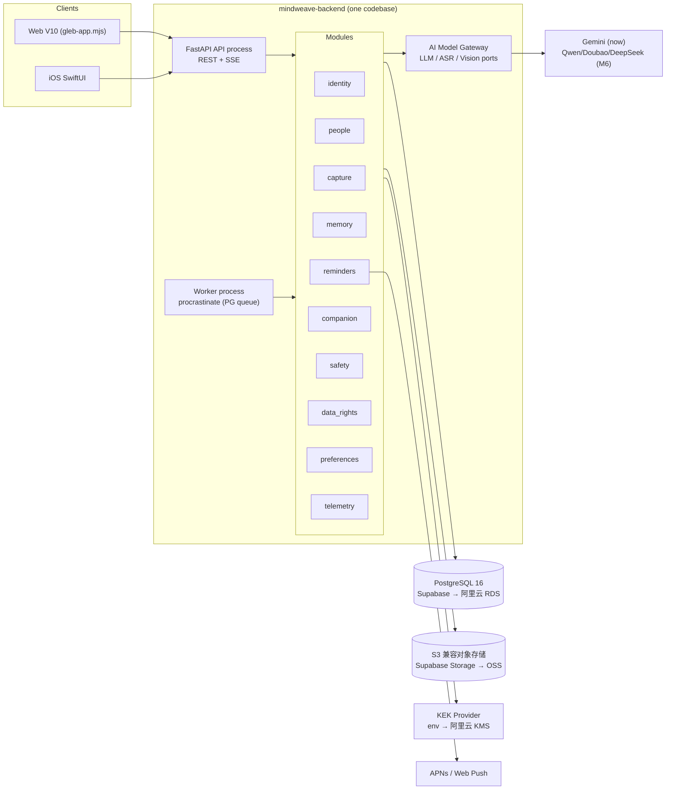
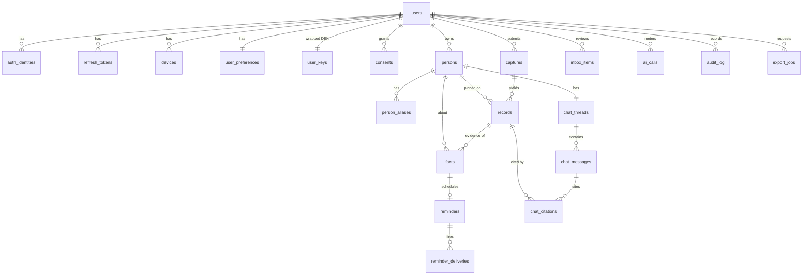
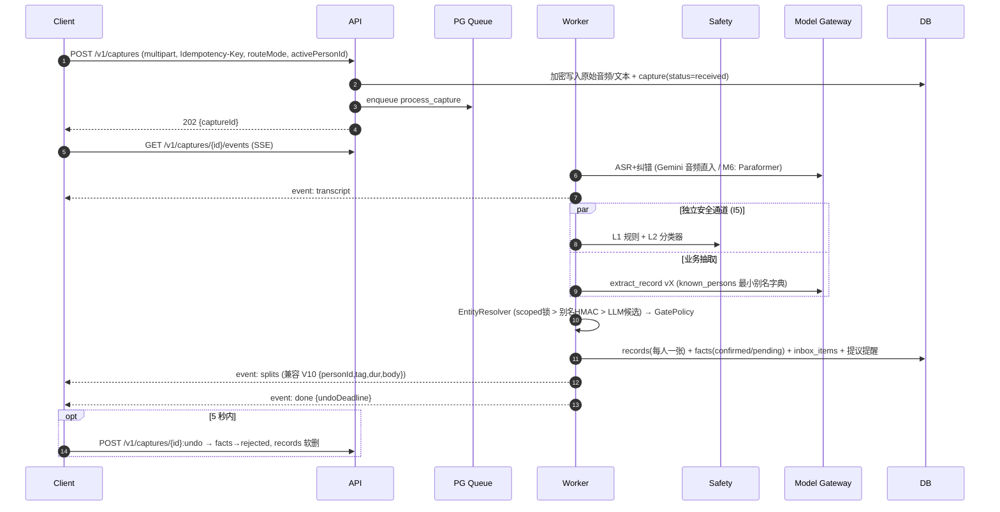
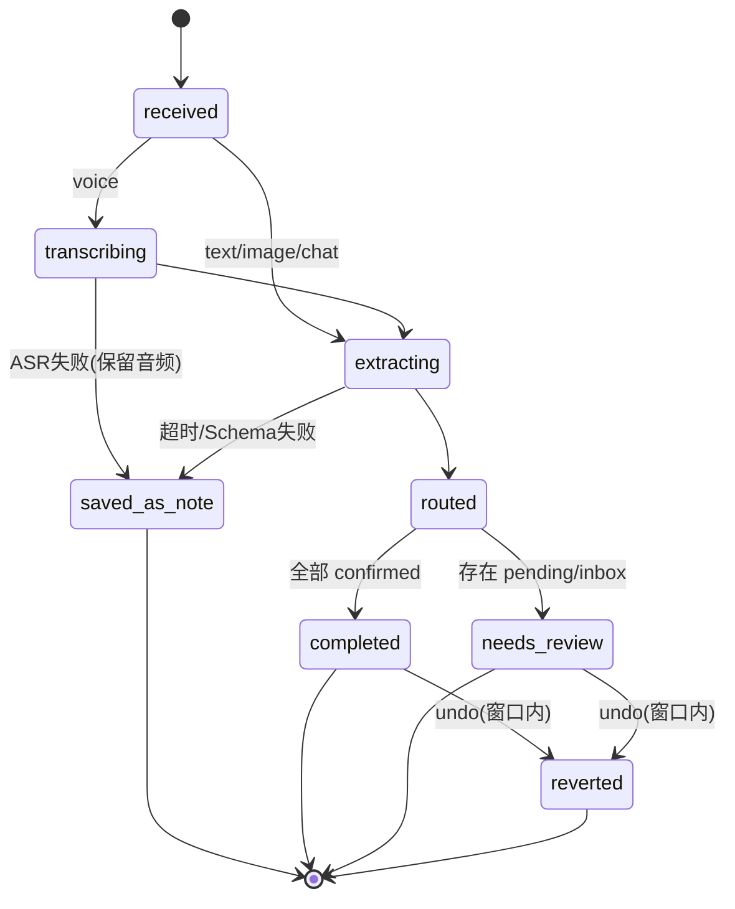
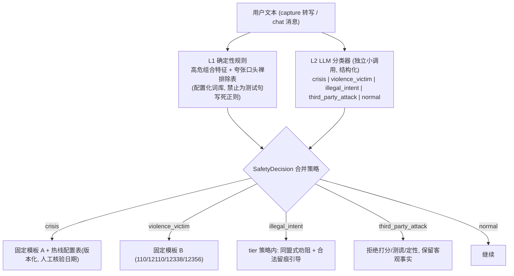
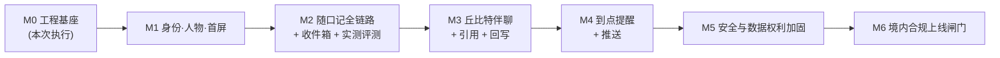

# 心络 MindWeave · 后端总体开发方案（Backend Master Plan v1.0）

> 依据：Drive 两个资料包全量阅读，包括 `PRD_v6`、`BACKEND_ARCHITECTURE_AND_API_SPEC_20261112`（下称「V10 规范」）、ADR-001～005、`not_to_do`、`assumptions`、PIA v0.2、危机 SOP v0.2、`extract_record` / `ask_relationship` v1.1 Prompt、`eval/`、`gemini_self_server.py`、定稿前端 `option_d_gleb_kinetic_stone/gleb-app.mjs`、iOS `MindWeaveStore.swift`、63 条用户原始指令日志、5 路研究深潜。
> 已拍板的前提：**Python 3.12 + FastAPI**；**现阶段模型全部接 Gemini，合规上线前切换境内备案模型**；**现阶段数据放 Supabase，合规上线前迁回境内**；本方案获批后交付「正式方案文档 + 可运行后端骨架」。

---

## 0. 目标

为心络后续**所有**后端开发定一套统一的宏观架构，具体包括：

- **架构铁律**：任何一步实现都不能违反；
- **模块边界**：每个功能往哪里放；
- **数据与契约**：前端（Web V10、iOS）对接什么；
- **AI 管线**：怎么抽取、怎么检索、怎么引用、怎么保证安全；
- **阶段路线**：M0 → M6，每一步有准出标准，最后一步是「境内合规上线闸门」。

这样今天为了快而选的 Gemini + Supabase，到上线前只需替换适配层，不用推倒重来。

---

## User Review Required

> [!CAUTION]
> **跨境数据红线（由你的选择 A2/A3 带来）**：Gemini 与 Supabase 都在境外，这一阶段的用户内容属于个人信息出境。因此 **M0–M5 只允许你本人自用或内部测试，测试数据用合成数据或你自己的数据，严禁向公众开放注册**。另外，Gemini 必须用**付费层 API**：免费层的输入可能被用于训练，违背 PIA「绝不用于训练」的承诺。M6 闸门全部通过之前，不得对外发布。

> [!IMPORTANT]
> **「记恨（silver）」尺度以你的最新裁决为准。** `not_to_do.md` §1.3（标了 🔒）写的是「不做 100% 无条件护短」，而你在 Step 3501 裁决、ADR-005 和 V10 规范里要求「100% 顺着用户发泄、绝不替对方辩解」。本方案采用后者，同时在后端强制保留三条底线：不对第三方打分或定性、不生成对外传播的挂人内容、对具体违法意图温和拉住。`not_to_do.md` 需要同步修订，请确认。

> [!IMPORTANT]
> **V10 规范需要补的缺口。** 方案会补齐 V10 规范里没有的：结构化事实 `facts`、待确认收件箱 `inbox`、到点提醒 `reminders`、聊天回写手帐、导出与注销、配额、审计。V10 的 `scrapbook_materials` 统一为 `records`（原始材料，也是引用单位），对前端仍以 `materials` 的名义暴露，**前端现有数据形状不用改**。

> [!WARNING]
> **术语统一。** 数据库与 API 唯一的规范枚举是 `tier ∈ {gold, silver, crystal}`，对应关系为 gold=记爱(love)、silver=记恨(hate)、crystal=记繁琐(matter)。iOS 端现在用的 `love/matter/hate` 要在对接时迁移。

> [!WARNING]
> **现有评测数字不能当能力证据。** `eval` 的 94.3% 是 dry-run 下照着测试原句写死正则得到的，`--mode=live` 根本不调 LLM，pillar 10 条样本也没有被加载。M2 起以本方案的 Python 评测框架实测结果为准。

## Open Questions（不阻塞 M0，进入相关里程碑前需要定）

1. **登录方式**：Sign in with Apple + 邮箱 OTP 两种起步，境内上线时补手机号短信。是否接受？（M1 前定）
2. **截图原图默认策略**：PIA 写的是「提取后即焚，用户主动选择才加密保留」，语音原声默认加密保留，因为 UI 有「原声签」需要回放。是否接受？（M2 前定）
3. **新人物策略**：V10 规范要求自动建档，Lane5 要求不得静默入库。本方案的折中是：自动建一个 `provisional` 状态的 crystal 人物，并在收件箱发一条「新人物确认」，该人物名下的事实全部进 pending。是否接受？（M2 前定）
4. **对话配额**：每日条数的初始值，例如每日 100 条 `[假设]`。（M3 前定）
5. **Supabase 区域**：建议选新加坡（ap-southeast-1），延迟最低。

---

## 1. 架构总览

### 1.1 形态：模块化单体（Modular Monolith）+ 六边形分层 + 同库异步 Worker



**为什么选模块化单体**：

- 用户规模和数据量都很小。文档里的结论是每人 3–15 个关系、每人有效事实不超过 100 条；
- 团队也小，微服务只会增加运维和一致性成本；
- 模块边界用 `import-linter` 在 CI 里强制检查。将来如果真要拆，比如把 AI Worker 独立出去，按模块切开即可。

**为什么用 Postgres 做队列（procrastinate）**：

- 少一个 Redis；
- Supabase 和阿里云 RDS 都能用，迁移时零改动；
- `SELECT … FOR UPDATE SKIP LOCKED` 在本项目的量级下绰绰有余。

### 1.2 每个模块内部的分层（依赖只能向内）

```text
modules/<name>/
  api/           # FastAPI routers + 请求/响应 DTO（camelCase），只调 application
  application/   # 用例（Command/Query handler）、事务边界、调用 ports
  domain/        # 实体、值对象、纯函数策略（门禁、箭矢流转、引用校验），零 IO
  infra/         # SQLAlchemy 仓储、外部适配器实现
```

CI 架构测试检查以下几条：

- `domain` 不能 import `sqlalchemy`、`fastapi`、任何厂商 SDK；
- 模块之间只能通过对方的 `application` 公共接口或领域事件交互；
- 只有 `ai/adapters/*` 可以 import `google.genai` 等厂商 SDK。

### 1.3 十二条架构铁律（Invariants）

> 任何 PR 违反其中一条都直接驳回。每条都有对应的自动化守护。

| # | 铁律 | 来源 | 自动化守护 |
| :-- | :-- | :-- | :-- |
| I1 | **租户与人物硬隔离**：每张用户数据表都带 `user_id`，仓储方法必须传 `UserScope`；AI 上下文只能通过 `PersonScope(user_id, person_id)` 获取；Postgres RLS 作为第二道防线 | PRD §7.1、ADR-002 | 架构测试 + RLS 集成测试 + 串扰评测（一票否决） |
| I2 | **绝不丢用户输入**：原始输入先持久化，再调 AI；AI 失败时存成 `note` 并标 pending | PRD F1 | 管线故障注入测试 |
| I3 | **入库门禁由服务端确定性策略决定**：LLM 只负责给出信号 | PRD §6、Lane5 | `GatePolicy` 单测矩阵 |
| I4 | **引用必须可验证**：`cited ⊆ 本次上下文 record_ids`，越界的引用剥离 | PRD 契约 2 | 引用校验器单测 + 虚构引用评测（一票否决） |
| I5 | **安全检测是独立通道**：不和业务抽取共用同一次 LLM 调用；危机卡片文案用固定模板，AI 不得改写 | 危机 SOP、Lane5 | 安全评测 + 模板快照测试 |
| I6 | **展示字段不得出现开发侧用语** | AGENTS.md、V10 §一.4 | 响应文案 lint（禁词表） |
| I7 | **切换箭矢绝不删除历史**，排序用分数索引 | V10 §一.1 | 领域单测 |
| I8 | **数据可导出、可删除**：每张用户数据表都必须在 `DataRightsRegistry` 里注册 | 个保法 45/47 | 测试：新表未注册时 CI 失败 |
| I9 | **厂商中立**：业务代码只依赖 Gateway port；Prompt 带版本号；换模型必须过评测回归 | ADR-001 | 架构测试 + 评测门禁 |
| I10 | **日志和埋点零正文**：logs、traces、telemetry、ai_calls 都不记录正文和人名 | PRD §8 | 日志脱敏处理器 + 测试 |
| I11 | **写接口幂等**：所有写接口带 `Idempotency-Key`；ID 由客户端生成（UUIDv7），支持离线草稿重放 | PRD F1 严重错误态 | 重放测试 |
| I12 | **正文字段加密存储**：正文字段在应用层用信封加密（每用户一把 DEK）；注销时销毁 DEK（crypto-shredding） | PIA 护盾 1/2 | 加解密 / 销毁测试 |

---

## 2. 领域模型与数据库

### 2.1 概念统一（解决 PRD、V10、iOS 三套命名的冲突）

| 概念 | 表 | 说明 |
| :-- | :-- | :-- |
| 人物 | `persons` + `person_aliases` | 统一承载 gold/silver/crystal 三档；状态为 `active / provisional / archived` |
| 一次输入 | `captures` | 一次语音、文字、截图或聊天回写，对应一个异步任务及其状态机 |
| 原始材料 | `records` | 手帐上的「便签 / 拍立得 / 原声签」，也是 **`[rec_id]` 引用单位**。API 对外叫 `materials` |
| 结构化事实 | `facts` | 偏好、雷区、日期、心愿、承诺、事件、备注；带 `pending / confirmed / rejected` 状态和双时序字段 |
| 待确认收件箱 | `inbox_items` | 人物消歧、新人物确认、事实确认、气话暂存 |
| 提醒 | `reminders` + `reminder_deliveries` | 由已确认的 date/promise 事实派生 |
| 伴聊 | `chat_messages` + `chat_citations` + `chat_threads` | 每个人物一条线程，保存滚动摘要 |

一次输入的展开关系：一次 global 语音（capture）拆成 N 张人物便签（records，每人一张），每张便签再抽出 M 条事实（facts）。

### 2.2 ER 图



### 2.3 关键表定义（节选，完整 DDL 由 Alembic 基线迁移生成）

`*_enc` 列为 `bytea`，存放 AES-256-GCM 密文，格式 `nonce‖ciphertext‖tag`，AAD 为 `table:column:row_id`，防止密文被挪到别的行使用。

```sql
CREATE TABLE persons (
  id            uuid PRIMARY KEY,                 -- UUIDv7，可由客户端生成
  user_id       uuid NOT NULL REFERENCES users(id) ON DELETE CASCADE,
  tier          text NOT NULL CHECK (tier IN ('gold','silver','crystal')),
  rank          text NOT NULL,                    -- 分数索引 (LexoRank)，同 tier 内排序 → coreIds / casualIds
  state         text NOT NULL DEFAULT 'active' CHECK (state IN ('active','provisional','archived')),
  display_name_enc bytea NOT NULL,
  monogram      text NOT NULL,                    -- 单字印章（展示必需，低敏）
  role_tag_enc  bytea, context_sub_enc bytea, short_memo_enc bytea,
  has_photo     boolean NOT NULL DEFAULT false,   -- crystal 默认无照片，avatar 非必填
  avatar_object_key text,
  visual_tokens jsonb NOT NULL DEFAULT '{}',      -- sealBg/sealColor/tapeColor/tabColor
  version       int NOT NULL DEFAULT 1,           -- 乐观锁
  created_at timestamptz NOT NULL DEFAULT now(), updated_at timestamptz NOT NULL DEFAULT now()
);
CREATE INDEX ON persons (user_id, tier, rank);

CREATE TABLE person_aliases (                     -- 实体解析的确定性第一跳
  id uuid PRIMARY KEY, user_id uuid NOT NULL, person_id uuid NOT NULL REFERENCES persons(id) ON DELETE CASCADE,
  alias_hmac bytea NOT NULL,                      -- HMAC(user_key, normalize(alias))：可做等值匹配又不落明文
  alias_enc bytea NOT NULL, kind text NOT NULL    -- name|nickname|title
);
CREATE UNIQUE INDEX ON person_aliases (user_id, alias_hmac, person_id);

CREATE TABLE captures (
  id uuid PRIMARY KEY, user_id uuid NOT NULL,
  source text NOT NULL CHECK (source IN ('voice','text','image','chat')),
  route_mode text NOT NULL CHECK (route_mode IN ('global','current')),
  scoped_person_id uuid REFERENCES persons(id) ON DELETE SET NULL,
  status text NOT NULL,                           -- 见 §3.2 状态机
  audio_object_key text, image_object_key text, duration_ms int,
  raw_text_enc bytea, transcript_enc bytea, transcript_marked_enc bytea,
  safety_outcome text, prompt_version text, model_profile text,
  undo_deadline timestamptz, idempotency_key uuid NOT NULL,
  created_at timestamptz NOT NULL DEFAULT now(), completed_at timestamptz,
  UNIQUE (user_id, idempotency_key)
);

CREATE TABLE records (                            -- = materials
  id uuid PRIMARY KEY, user_id uuid NOT NULL,
  person_id uuid NOT NULL REFERENCES persons(id) ON DELETE CASCADE,
  capture_id uuid REFERENCES captures(id) ON DELETE SET NULL,
  kind text NOT NULL CHECK (kind IN ('photo','note','voice')),
  title_enc bytea NOT NULL, body_enc bytea NOT NULL, snippet_enc bytea,
  media_object_key text, audio_offset_ms int, audio_duration_ms int,
  stamp_code text, happened_on date, pinned boolean NOT NULL DEFAULT true,
  review_state text NOT NULL DEFAULT 'normal' CHECK (review_state IN ('normal','held','note_only')),
  created_at timestamptz NOT NULL DEFAULT now(), deleted_at timestamptz
);
CREATE INDEX ON records (user_id, person_id, created_at DESC);

CREATE TABLE facts (
  id uuid PRIMARY KEY, user_id uuid NOT NULL,
  person_id uuid REFERENCES persons(id) ON DELETE CASCADE,   -- 未消歧时可为空，此时必须挂在收件箱
  record_id uuid NOT NULL REFERENCES records(id) ON DELETE CASCADE,
  type text NOT NULL CHECK (type IN ('preference','taboo','date','wish','promise','event','note')),
  polarity text, source_speaker text CHECK (source_speaker IN ('target_person','user_self','narrator')),
  content_enc bytea NOT NULL, trigger_date date, trigger_time time, is_lunar boolean DEFAULT false,
  status text NOT NULL CHECK (status IN ('pending','confirmed','rejected')),
  pending_reason text,                            -- ambiguous_person|multi_person|date_or_promise|low_confidence|venting|new_person|extraction_failed
  confidence real, created_by text NOT NULL CHECK (created_by IN ('ai','user')),
  valid_at timestamptz NOT NULL DEFAULT now(), invalid_at timestamptz, superseded_by uuid,  -- 只借 Graphiti 的双时序字段，不引入图库
  prompt_version text, version int NOT NULL DEFAULT 1,
  created_at timestamptz NOT NULL DEFAULT now(), updated_at timestamptz NOT NULL DEFAULT now()
);
-- 伴聊上下文唯一合法的查询路径（I1）：
CREATE INDEX facts_ctx ON facts (user_id, person_id, status) WHERE invalid_at IS NULL;
```

其余表的要点：

- `inbox_items(kind, payload_enc, capture_id, fact_ids[], expires_at)`；气话类 72h 未处理自动降级为 `note_only`，时长可配置，来自 Lane5；
- `reminders(fact_id, person_id, rule: once|yearly, lunar, lead_days[], next_fire_at, tz, status)`；
- `chat_messages(role, content_enc, whisper_enc, perspectives_enc, tier_snapshot, safety_flag, referenced_record_ids[])`；
- `ai_calls(task, provider, model, prompt_version, in_tokens, out_tokens, latency_ms, cost_micros, outcome)`，**不存任何正文**；
- `audit_log(actor, action, target_type, target_id, at, ip_hash)`；
- `user_keys(wrapped_dek, kek_id, created_at, destroyed_at)`。

**RLS**：每个请求的事务开头执行 `SET LOCAL app.user_id = :uid`，策略写成 `USING (user_id = current_setting('app.user_id')::uuid)`。应用层 `UserScope` 已经过滤一次，RLS 是第二道防线，防止开发者漏写 `WHERE`。

---

## 3. 核心业务流程

### 3.1 随口记（语音 / 文字 / 截图），对应断弧语音和三向路由



**路由规则**：

- `route_mode=current`：**硬锁** `scoped_person_id`。句中提到的其他人物，事实另拆出来，放进对方名下的 pending；
- `route_mode=global`：做多人物拆分；
- 前端判定为取消的录音**不发请求**。

**入库门禁 `GatePolicy`**（纯函数，阈值可配置，默认 0.80，按 PRD 取值；用实测评测校准后再调）。满足以下任一条件的事实进 pending，否则直接 confirmed，并给 5 秒撤销窗口：

1. 候选人物数 ≠ 1；
2. 一句话涉及两人及以上，且不在 scoped 锁定范围内；
3. 类型是 `date` 或 `promise`，因为需要确认提醒时间；
4. `confidence < threshold` 或极性反转；
5. `is_venting_or_irony` 为真，且对象是 gold；
6. 人物处于 `provisional` 状态；
7. 截图里 `source_speaker` 无法判定，比如群聊；
8. 抽取失败或 Schema 校验失败，此时存成 `note`，`pending_reason=extraction_failed`。

**截图**：

- Gemini 多模态直接输出带 `[LEFT_BUBBLE/对方]`、`[RIGHT_BUBBLE/我]` 标注的气泡；右侧气泡只抽 `promise`；
- 原图默认在提取后**销毁**，除非用户选择保留（Open Question 2）；
- 上传后统一剥离 EXIF。

**实时转写浮窗**（微信式）：

- M2 由客户端负责实时预览，iOS 用 `SFSpeechRecognizer`，Web 用 Web Speech API；松手后以服务端的「ASR + AI 纠错」结果为准；
- 服务端 WebSocket 流式 ASR 推迟到 M6，接入境内流式 ASR 时再做。这样 MVP 不必自己维护长连接。

### 3.2 Capture 与 Fact 的状态机



Fact 的状态流转：

- `pending` 可转为 `confirmed`、`rejected`，或者「仅存普通日记」：此时 record 改为 `note_only`，fact 改为 `rejected`；
- `confirmed` 状态下如果出现新信息，旧 fact 写入 `invalid_at`，并设置 `superseded_by`，**不做物理覆盖**。

### 3.3 丘比特伴聊（按人物隔离，SSE 流式输出，引用可核验）

```mermaid
sequenceDiagram
  participant C as Client
  participant A as API (companion)
  participant S as Safety
  participant X as ContextBuilder
  participant G as Gateway
  C->>A: POST /v1/persons/{id}/chat/messages {message, referencedMaterialIds, clientMsgId}
  A->>A: 配额检查 / 深夜时长监测
  A->>S: 用户消息安全预检
  alt crisis / violence_victim
    A-->>C: event: crisis {templateId, hotlines}  (固定模板, 停止常规回答)
  else normal / illegal_intent / third_party_attack
    A->>X: PersonScope 拉取: persons.traits + 全部 confirmed facts + 引用素材正文 + 最近 12 轮 + 线程滚动摘要
    X->>G: stream(prompt=ask_relationship vX + tier_policy[gold|silver|crystal])
    G-->>A: tokens (标签化输出协议 <reply>/<whisper>/<perspectives>/<suggestions>)
    A->>A: StreamingCitationProcessor: 归一化 [rec_x] → 校验 ⊆ ctx → 转 citation 事件; 越界剥离
    A-->>C: event: delta / citation / whisper / perspective(仅gold) / suggestion
    A->>A: 后置校验: silver ⇒ perspectives=[]; 依赖话术/第三方打分禁词
    A-->>C: event: done {messageId}
    A->>A: 异步: 用户消息 → capture(source=chat) → 事实回写手帐(走门禁)
  end
```

**检索策略**：不用向量库，按人物全量拉取，研究结论一致。

- 每人有效事实不超过 100 条，约 4k token。用 Top-K 截取反而会漏掉忌口；
- 超出预算时，`taboo / date / promise` 必选，其余按时间倒序补齐；
- 何时重新评估：单人物有效事实超过 300 条，或上下文 P95 超过 8k token。届时在 `WHERE person_id` 的**前提下**引入 pgvector，依然只在单人物范围内检索。

**tier 策略**用代码管理（`companion/domain/tier_policy.py`），由三部分组成：Prompt 片段、输出约束、后置校验器。

| tier | 语气 | perspectives | 特殊 |
| :-- | :-- | :-- | :-- |
| gold 记爱 | 先共情、再温和引导 | 允许（前端渲染为折叠卡） | 气话回写走 venting 暂存 |
| silver 记恨 | 坚定同盟，不和稀泥 | **强制 `[]`** | 可起草留痕邮件或事实时间线；遇到违法意图温和拉住；不生成外发挂人内容 |
| crystal 记繁琐 | 干练、讲分寸 | `[]` | 侧重忌口、档期、礼数 |

**UI 上不出现原始 ID**：`[rec_id]` 只在后端内部使用。前端收到 `citation{index, materialId, title, snippet}` 事件后，自行渲染成素材角标。

### 3.4 到点提醒

- **派生**：fact 被确认、且类型为 date/promise 时，生成 `reminder(status=proposed)`，用户确认后转为 active。生日、纪念日支持 `yearly` 和**农历**（`lunar_python` 库）。默认提前天数为 `[7,1,0]`，可配置；
- **调度**：procrastinate 周期任务每分钟执行一次 `SELECT … WHERE next_fire_at <= now() FOR UPDATE SKIP LOCKED`。投递成功后写入 `reminder_deliveries`，再计算 `next_fire_at`。投递是幂等的，键为 `(reminder_id, fire_at)`；
- **通道**：iOS 走 APNs（`aioapns`），Web 走 Web Push VAPID（`pywebpush`）。**通知文案默认脱敏**，例如「有一个重要日子快到了」，不含人名和正文（PRD §7.6）；
- **禁止**：替用户代发祝福；拟人化的求聊推送（not_to_do、危机 SOP §三）。

### 3.5 安全子系统（独立通道）



- **故障安全**：L2 超时时，如果 L1 命中，就展示关怀卡（不锁屏、不吞数据）；L1 和 L2 都未命中则继续正常流程。**危机状态下用户输入照样保存**；
- **界面上不展示任何风险分数**；只记录埋点 `crisis_flow_entered{trigger_category}`；
- **深夜关怀**：00:00–05:00 之间连续对话超过 45 分钟 `[假设]` 时，在回复末尾追加一句关怀语，文案来自 SOP；
- 危机话术和热线在 M6 上线前要经心理专业人士审核，热线号码要人工拨打核验。

### 3.6 数据主权：导出、删除与注销

- **导出**：`POST /v1/me/exports` 异步生成 zip，内含：
  - `data.json`：完整、机器可读，带 schema 版本；
  - `journal.md`：按人物组织，方便人阅读；
  - `media/`：解密后的原始媒体；
  - 元数据里写入 GB 45438 规定的隐式 AIGC 标识。

  zip 用一次性下载链接发放，24h 过期。导出前要求二次验证（re-auth）。
- **注销**：re-auth 通过后：
  1. 账号立即锁定；
  2. **立即销毁该用户的 DEK**，从这一刻起数据在密码学上不可读；
  3. 24h 内由任务物理删除数据库行和对象；
  4. 备份按 PITR 窗口（例如 7 天）自然过期，这一点要在隐私政策里如实披露。
- **单条或单人物删除**：软删，30 天后物理删除，期限可配置；人物删除时级联删除其名下的 records、facts、chat 数据。
- `DataRightsRegistry`：每张用户数据表都要声明导出方式和删除方式。**新增的表如果没注册，CI 直接失败**（I8）。

---

## 4. AI Model Gateway（今天 Gemini，M6 切境内）

```text
ai/
  ports.py        # LLMPort.generate_structured / stream ; ASRPort.transcribe ; (Vision 走多模态 LLM)
  gateway.py      # 按 task 路由: extract | chat | safety_classify | transcribe | screenshot | summarize
  routing.yaml    # task → [primary, fallback...] 模型 profile（环境变量覆盖）
  adapters/
    gemini.py     # google-genai SDK; 音频/图片直入; response_schema 结构化输出
    fake.py       # 确定性假实现: 单测/CI/离线开发
    dashscope.py  # (M6) 通义 OpenAI 兼容 / Paraformer ASR
    ark.py        # (M6) 豆包
    deepseek.py   # (M6)
  prompts/        # registry: 读取 /prompts/*.md front-matter {id, version}, 计算内容 hash 写入 ai_calls
  schemas/        # Pydantic: ExtractRecordOut v1.1, AskRelationshipOut v1.1, SafetyOut
  validators/     # JSON 修复重试 1 次 → 失败降级; 引用校验; 禁词校验
  metering.py     # token/延迟/成本 → ai_calls (零正文)
```

Gateway 统一负责以下横切能力：

- **可靠性**：每个 task 有独立的超时，指数退避加抖动重试（`tenacity`），每个 provider 一个熔断器，失败时按 fallback 链降级；
- **结构化输出**：Schema 校验失败时修复重试 1 次，仍失败就交给上层降级（I2）；
- **Prompt 管理**：Prompt 版本号写进每一条 capture、fact、message，可追溯；
- **成本计量**：按 A-08 公式统计，单用户每日成本可查；
- **缓存**：**禁止语义缓存**，只允许厂商侧的前缀缓存。

**Gemini 阶段约束**：

- 必须用付费层，开启零留存或不训练选项；
- 型号写在配置里，不硬编码；
- 业务代码一律不 import `google.genai`。

**M6 切换方式**：先在评测集上做 A/B，对比 Qwen-Plus、Doubao-pro、DeepSeek-V3（禁用 R1）的串扰率、虚构引用率、归档准确率、危机召回、P95 延迟和成本，然后改 `routing.yaml` 即可完成切换（ADR-001）。

---

## 5. API 契约（`/v1`，OpenAPI 3.1 作为单一事实源）

**统一约定**：

- **格式**：JSON 一律 camelCase，与 `gleb-app.mjs` 保持一致；错误按 RFC 7807 `application/problem+json` 返回；分页用游标；
- **写接口**：必须带 `Idempotency-Key`；更新类接口用 `If-Match: <version>` 做乐观锁；
- **流式**：SSE 事件名按本方案固定；
- **客户端生成**：FastAPI 生成的 `openapi.json` 入库，TS 客户端用 `openapi-typescript`、Swift 客户端用 `swift-openapi-generator` 生成；CI 用 `schemathesis` 跑契约模糊测试，并做契约 diff，破坏性变更会被拦下。

| 域 | 端点 | 里程碑 |
| :-- | :-- | :-- |
| 健康 | `GET /healthz` `GET /readyz` | M0 |
| 身份 | `POST /v1/auth/apple`、`POST /v1/auth/email/otp:request`、`…/otp:verify`、`POST /v1/auth/refresh`、`POST /v1/auth/logout` | M1 |
| 首屏 | `GET /v1/bootstrap` → `{preferences, coreIds, casualIds, people{}, inboxCount}`，形状对齐 `state` 与 `PEOPLE_DB` | M1 |
| 人物 | `GET/POST /v1/persons`、`GET/PATCH/DELETE /v1/persons/{id}`、`PATCH /v1/persons/{id}/tier`（响应与 V10 一致：`{personId, previousTier, tier, coreIds, casualIds}`）、`POST /v1/persons/{id}:move`（排序）、`/v1/persons/{id}/aliases` | M1 |
| 偏好 | `GET/PATCH /v1/me/preferences`（edition、cupidLayout、wallpaper、blur、vignette）、`POST /v1/me/wallpaper` | M1 |
| 随口记 | `POST /v1/captures`、`GET /v1/captures/{id}`、`GET /v1/captures/{id}/events`（SSE：`transcript`/`splits`/`needs_review`/`done`/`error`）、`POST /v1/captures/{id}:undo` | M2 |
| 素材 | `GET /v1/persons/{id}/materials`、`GET/PATCH/DELETE /v1/materials/{id}`、`GET /v1/materials/{id}/media`（流式解密） | M2 |
| 事实 | `GET /v1/persons/{id}/facts`、`PATCH/DELETE /v1/facts/{id}` | M2 |
| 收件箱 | `GET /v1/inbox`、`POST /v1/inbox/{id}:resolve {action: confirm\|keep_as_note\|discard\|assign_person\|create_person\|merge_person}` | M2 |
| 伴聊 | `GET /v1/persons/{id}/chat/messages`、`POST /v1/persons/{id}/chat/messages`（SSE：`delta`/`citation`/`whisper`/`perspective`/`suggestion`/`crisis`/`done`/`error`） | M3 |
| 提醒 | `GET/POST /v1/reminders`、`PATCH/DELETE /v1/reminders/{id}`、`POST /v1/reminders/{id}:done`、`POST /v1/devices` | M4 |
| 数据权利 | `POST /v1/me/exports`、`GET /v1/me/exports/{id}`、`DELETE /v1/me`（re-auth）、`GET /v1/me/consents` | M5 |

**语音上传限制**：单条不超过 120s、10MB，格式支持 webm/m4a/wav；图片不超过 10MB。服务端会嗅探真实 MIME 类型。媒体文件**统一经 API 上传**，由服务端加密后再写入对象存储，不提供预签名直传，以保证 I12 和 crypto-shredding 成立。

---

## 6. 横切关注点

- **身份**：
  - access JWT 有效期 15 分钟（EdDSA）；refresh token 轮换，并检测重放；存储时只存 hash；
  - Apple 登录用 JWKS 校验；邮箱 OTP 6 位，10 分钟过期，带限流；
  - **自建 auth 模块，不用 Supabase Auth**，避免迁移时搬不动用户体系。
- **加密**：
  - `CipherPort` 有两个实现：`LocalKekProvider` 从环境变量读 KEK，`AliyunKmsProvider` 留到 M6；
  - 每个用户一把 DEK，用 AES-256-GCM；DEK 解包后在进程内缓存不超过 5 分钟；
  - 别名等值匹配用 HMAC 盲索引。
- **PII**：调模型前先用确定性正则掩码硬 PII（身份证、银行卡、手机号、明文密码），保留称呼和地名（PIA 护盾 3）。
- **可观测性**：
  - `structlog` 输出 JSON 日志，接入脱敏处理器；
  - OpenTelemetry trace 贯穿 `request_id` 和 `capture_id`；
  - Sentry 开启 `send_default_pii=False`，并在 `before_send` 里清洗数据；
  - 指标覆盖：管线各阶段耗时、门禁 pending 率、撤销率、危机触发数、AI 成本。
- **埋点**：按 PRD §8 的事件表实现，后端只接收白名单字段，正文和姓名一律拒收。
- **限流与配额**：按用户 + 路由做令牌桶（M0 先放在单实例内存，M5 迁到 PG 实现）。对话配额和录音分钟数配额是两套配置。
- **NFR**（全部标 `[假设]`，按 R1 实测后再定）：
  - capture 受理 P95 不超过 300ms（只算服务端）；
  - 随口记端到端 2–6s（A-07）；
  - 伴聊首 token 不超过 1.5s；
  - 可用性 99.5%。
- **退役项**：`gemini_self_server.py` 会把完整请求正文写进 `live_inbox.json`，违反 I10。新后端上线时正式退役，iOS 端的 `NSAllowsArbitraryLoads` 同时移除。

---

## 7. 工程结构（M0 交付）

```text
/home/antigravity/mindweave-backend/
├── pyproject.toml                 # uv 管理; ruff + mypy(strict) + pytest 配置
├── .importlinter                  # 分层/模块边界契约
├── docker-compose.yml             # postgres:16 + minio(S3) + api + worker
├── Dockerfile                     # 多阶段, 非 root
├── Makefile                       # dev / test / lint / migrate / openapi / eval
├── .github/workflows/ci.yml       # lint → type → unit → arch → migrate+integration(PG service) → openapi diff
├── alembic.ini, migrations/       # 0001_baseline: 全部 MVP 表 + RLS 策略
├── prompts/                       # extract_record v1.1, ask_relationship v1.1, safety_classify v0.1 (front-matter 版本化)
├── openapi/openapi.json
├── evals/                         # Python 评测框架: datasets(迁入 45 条 + pillar), runner(offline/live), metrics, reports
├── docs/
│   ├── BACKEND_MASTER_PLAN.md     # 本方案定稿
│   └── adr/ 006…013               # 见 §9
├── src/mindweave/
│   ├── main.py                    # app factory, 中间件(request_id, 脱敏日志, problem+json, CORS)
│   ├── core/                      # config(pydantic-settings), db(async SQLAlchemy+RLS 会话), ids(uuid7), clock, errors, logging, security(jwt), crypto(CipherPort)
│   ├── shared/                    # UserScope, PersonScope, 领域事件总线, DataRightsRegistry
│   ├── modules/
│   │   ├── identity/  people/  capture/  memory/  reminders/
│   │   ├── companion/ safety/  data_rights/  preferences/  telemetry/
│   │   │   └── {api, application, domain, infra}/
│   ├── ai/                        # ports, gateway, routing.yaml, adapters(fake, gemini), prompts registry, schemas, validators, metering
│   └── workers/                   # procrastinate app + 任务注册
└── tests/
    ├── unit/                      # GatePolicy, TierTransition, CitationValidator, SafetyL1, Cipher, PromptRegistry
    ├── integration/               # 迁移 + RLS 隔离 + 健康检查
    ├── architecture/              # import-linter + DataRightsRegistry 完整性
    └── contract/                  # OpenAPI 快照
```

**M0 骨架里直接写实的部分**（承载铁律的核心纯函数，有完整单测）：

- `GatePolicy`（I3）
- `TierTransition` 加分数索引排序（I7）
- `CitationValidator` 及流式版本（I4）
- `SafetyRuleEngine` L1，配置化词库（I5）
- `EnvelopeCipher`（I12）
- `PromptRegistry`（I9）
- `ModelGateway`，含 Fake 和 Gemini 两个适配器（I9）
- 日志脱敏处理器（I10）
- `DataRightsRegistry` 完整性检查（I8）

其余模块先建好目录、端口接口和路由占位，到对应里程碑再实现。

**主要依赖**：

- Web 与校验：`fastapi`、`uvicorn[standard]`、`pydantic>=2`、`pydantic-settings`；
- 数据库与队列：`sqlalchemy[asyncio]>=2`、`asyncpg`、`alembic`、`procrastinate`；
- 流式与 HTTP：`sse-starlette`、`httpx`、`tenacity`；
- 安全：`cryptography`、`pyjwt[crypto]`；
- 日志与追踪：`structlog`、`opentelemetry-*`、`sentry-sdk`；
- AI 与存储：`google-genai`、`aioboto3`；
- 工具：`uuid-utils`、`lunar_python`；
- 开发：`ruff`、`mypy`、`pytest`、`pytest-asyncio`、`import-linter`、`schemathesis`。

---

## 8. 里程碑路线图与准出标准



| 里程碑 | 范围 | 准出标准（DoD） |
| :-- | :-- | :-- |
| **M0** | §7 全部 | `make lint test` 全绿；迁移能在真实 PG 上执行 upgrade/downgrade；RLS 隔离测试通过；`/healthz` `/readyz` 可用；OpenAPI 已导出；import-linter 通过 |
| **M1** | auth、bootstrap、persons/tier/aliases、preferences | V10 前端从 mock `PEOPLE_DB` 切到 `/v1/bootstrap`；切换 tier 后历史数据零丢失；首次启动数据为空（不预置虚构人物） |
| **M2** | captures、ASR、抽取、实体解析、门禁、收件箱、materials、undo、截图 | **跨人串扰率 = 0**；抽取失败零丢数据；global 语音按人拆分的结果与 V10 `splits` 形状一致；live 评测基线报告产出，评测集扩充到 ≥150 条 |
| **M3** | 伴聊 SSE、ContextBuilder、tier 策略、引用流处理、回写、配额 | **校验后虚构引用率 = 0**；silver 模式下 perspectives 恒为空；危机样本召回 100%（在评测集上） |
| **M4** | 提醒派生、农历、调度、APNs/Web Push | 到点误差 ≤ 1 分钟；重复投递为 0；通知内容已脱敏 |
| **M5** | 安全 L2 全量、深夜关怀、导出、注销、审计、PG 限流、压测 | 导出能完整还原；注销后 DEK 销毁、数据不可读；渗透自查清单全部通过 |
| **M6** | 切换境内模型（A/B 后定主力模型）、境内流式 ASR、迁移到阿里云 RDS + OSS + KMS、短信登录、ICP 与生成式 AI 备案、GB 45438 显式和隐式标识、PIA 定稿、法务与心理专业审核 | **全部通过前不得对外开放**；迁移演练做到零丢失；模型切换后评测结果不低于 Gemini 基线 |

---

## 9. 待落盘的 ADR（随 M0 交付）

| ADR | 主题 | 与旧 ADR 的关系 |
| :-- | :-- | :-- |
| 006 | Python/FastAPI 模块化单体 + 六边形分层 + PG 队列 | 落定 V10 路线 A |
| 007 | Model Gateway 与分阶段供应商策略（Gemini → 境内） | 临时豁免 ADR-001 / R9 至 M6，附闸门 |
| 008 | 分阶段数据托管（Supabase → 境内 RDS），只使用 PG 原生能力 + S3 协议 + 自建 Auth | 落定 ADR-002 的演进路线 |
| 009 | 字段级信封加密、盲索引、crypto-shredding | 落实 PIA 护盾 1/2 |
| 010 | 规范 tier 枚举与 Record/Fact/Material 概念统一 | 修订 V10 规范 §二 |
| 011 | 服务端写入门禁（Write-Before-Confirm Gate）与收件箱 | 落实 ADR-004 方案 A、ADR-005 |
| 012 | 不用向量库：按人物全量拉取，并写明重新评估的触发条件 | 落实 lane2 删-01/02 |
| 013 | 安全独立双层通道与固定危机模板 | 落实危机 SOP、Lane5 单点风险 |

---

## Proposed Changes（本次执行：M0）

### 文档
#### [NEW] `mindweave-backend/docs/BACKEND_MASTER_PLAN.md`：本方案定稿，按你的反馈修订
#### [NEW] `mindweave-backend/docs/adr/006…013-*.md`

### 工程骨架
#### [NEW] `pyproject.toml`、`.importlinter`、`Makefile`、`Dockerfile`、`docker-compose.yml`、`.github/workflows/ci.yml`、`.env.example`
#### [NEW] `src/mindweave/core/*`、`shared/*`、`main.py`
#### [NEW] `src/mindweave/modules/*/{api,application,domain,infra}`：核心领域策略写实，其余放占位
#### [NEW] `src/mindweave/ai/*`：Gateway、Fake/Gemini 适配器、Prompt 注册表、输出 Schema、校验器
#### [NEW] `migrations/versions/0001_baseline.py`：全部 MVP 表 + RLS
#### [NEW] `prompts/*.md`：迁入现有 v1.1 Prompt 并加 front-matter；新增 `safety_classify v0.1`
#### [NEW] `evals/`：Python 评测框架骨架，迁入 45 条样本 + pillar 10 条，提供 offline 模式（基于 Fake）
#### [NEW] `tests/{unit,integration,architecture,contract}`

示例：门禁策略的形态（领域纯函数）

```python
@dataclass(frozen=True)
class GateInput:
    fact_type: FactType
    confidence: float
    candidate_count: int
    multi_person: bool
    scoped_locked: bool
    venting: bool
    tier: Tier
    person_state: PersonState
    speaker_known: bool
    extraction_ok: bool


def decide(i: GateInput, cfg: GateConfig) -> GateDecision:
    if not i.extraction_ok:
        return pending(PendingReason.EXTRACTION_FAILED)
    if i.person_state is PersonState.PROVISIONAL:
        return pending(PendingReason.NEW_PERSON)
    if i.candidate_count != 1:
        return pending(PendingReason.AMBIGUOUS_PERSON)
    if i.multi_person and not i.scoped_locked:
        return pending(PendingReason.MULTI_PERSON)
    if i.fact_type in (FactType.DATE, FactType.PROMISE):
        return pending(PendingReason.DATE_OR_PROMISE)
    if i.venting and i.tier is Tier.GOLD:
        return pending(PendingReason.VENTING)
    if not i.speaker_known:
        return pending(PendingReason.SPEAKER_UNKNOWN)
    if i.confidence < cfg.threshold:
        return pending(PendingReason.LOW_CONFIDENCE)
    return confirmed(undo_window=cfg.undo_window)
```

---

## Verification Plan

### Automated Tests（在本 VM 执行）
```bash
cd /home/antigravity/mindweave-backend
uv sync
uv run ruff check . && uv run ruff format --check .
uv run mypy src
uv run lint-imports                       # 分层/模块边界
uv run pytest tests/unit tests/architecture -q
# 真实 Postgres：优先使用 pip 自带二进制的 pgserver 起本地 PG（VM 无 Docker 时）
uv run pytest tests/integration -q        # alembic upgrade/downgrade + RLS 跨用户隔离 + /readyz
uv run python -m mindweave.tools.export_openapi && git diff --exit-code openapi/
uv run python -m evals.run --mode offline # 评测框架冒烟(Fake 适配器)
```
另外会以 uvicorn 实际启动 API，用 `curl /healthz` 和 `curl /readyz` 验证服务可用。

### Manual Verification（你来确认）
1. 通读定稿文档和 ADR，重点核对 §1.3 铁律、§3.3 tier 策略、§8 里程碑划分是否符合你的产品意图；
2. 回复 Open Questions 1–5，未回复的按本文默认值执行；
3. 确认 `not_to_do.md` §1.3 的修订方向。

执行完成后我会写一份 walkthrough，汇总产出、测试结果和后续 M1 的入口。
