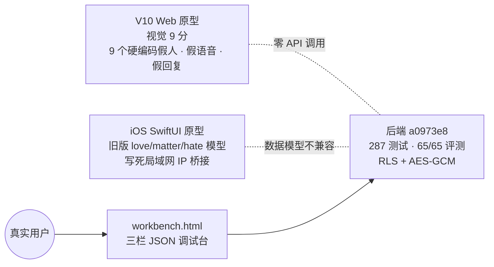
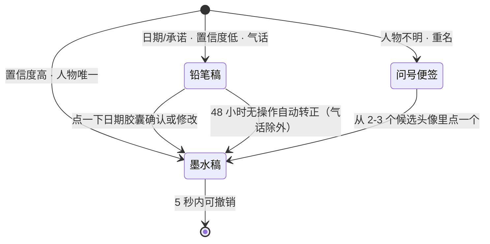
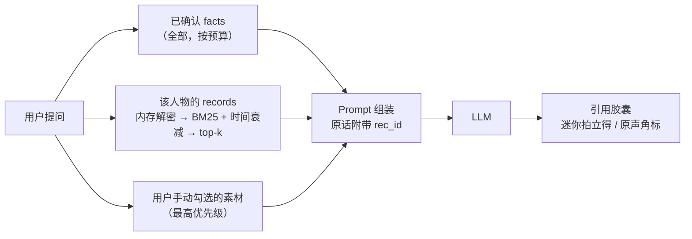
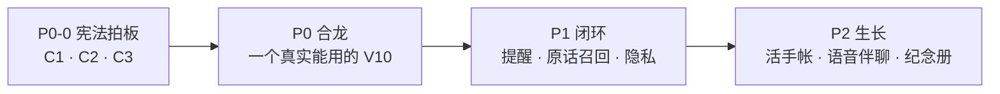

# 心络 MindWeave · 挑刺式产品审查与改进路线图

> 审查范围：V10 Web 原型（`web_prototypes/option_d_gleb_kinetic_stone/index.html` + `scripts/gleb-app.mjs`，2391 行）、iOS SwiftUI 原型（`ios/MindWeaveApp/`）、后端 [mindweave-backend](file:///home/antigravity/mindweave-backend)（commit `a0973e8`）、`PRD_v6.md`、`not_to_do.md`。
> 对标对象：Apple Journal、Day One、Things 3、Linear、微信按住说话、Dot / Pi。
> 原则：每条批评都写明代码位置；不编造数字。下文出现的目标值都是**待实测的目标**，不是测出来的结果。
> 注：原型和 iOS 文件位于 Drive 归档 `MindWeave_Core_Prototypes_Backend_Docs_20261112.tar.gz` 中，所以用归档内的相对路径标注。

---

## Part 0 · 总体判断

**心络目前还不是一个产品，而是一套漂亮的视觉方案加一个扎实但用户看不到的后端。**

两边做得都不差，但中间还没打通：



用户今天真正能接触到的，只有那个三栏 JSON 调试台，而这恰恰是你在 Step 4416 明确批评过的"开发者视角界面"。

### 真正做得好的地方（这部分不打折扣，否则后面的批评不可信）

| 做得好的 | 依据 |
|---|---|
| 人物级记忆隔离写进了数据库层，不靠提示词 | `FORCE RLS` + `PersonScope`，红队 4 轮最终 0 bug |
| 危机流程走固定审核话术，**不调用 LLM** | [service.py#L438-L510](file:///home/antigravity/mindweave-backend/src/mindweave/modules/companion/application/service.py#L438-L510) |
| 流式回复按句缓冲，带安全守卫和引用校验 | [service.py#L965-L1086](file:///home/antigravity/mindweave-backend/src/mindweave/modules/companion/application/service.py#L965-L1086) |
| 推送文案先做脱敏校验 | `validate_push_copy_safety` |
| V10 交互骨架有辨识度：断弧语音、三元 Dock、右缘抽屉、箭钉切换层级 | `gleb-app.mjs` L1781-L1861、L2009-L2078 |

---

## Part I · 产品宪法自相矛盾（必须先拍板，否则后面怎么做都会返工）

> [!CAUTION]
> 下面 3 处是**文档之间互相冲突**，不是代码 bug。如果不先定下来，工程做得越快，返工越多。

| # | 冲突 | A 方说 | B 方说 |
|---|---|---|---|
| **C1** | 银箭（记恨）的 AI 立场 | `PRD_v6.md` §4.1 F3：「**绝对同盟**……坚决不搞理客中……**完全顺着**用户的情绪发泄」 | `not_to_do.md` 第 3 条 🔒：「**不做 100% 无条件站在用户一边的护短嘴替**」；反模式表第 3 行：「记恨模块无条件护短……人为训练模型谄媚」 |
| **C2** | 模型与数据出境 | `not_to_do.md` 反模式第 10 条：「**仅选用国内已备案大模型**，数据存储在境内」；PRD §7.4 同样要求 | 现在的后端默认接 Gemini 适配器，部署方案是 Cloud Run（境外） |
| **C3** | 范围纪律 | PRD §4.1 F2：「提供**一套**……手帐视觉模板」；§4.3 把多套风格**推迟到 MVP 之后**；反模式第 2 条：「每轮评审删除数 ≥ 新增数」 | V10 原型里有 **6 套手帐主视觉 + 4 套丘比特形象 + 心情灵石 + 英文 Events 周历**，都在 MVP 范围里 |

**我的建议：**
- **C1**：改成「**情绪上 100% 站你这边，事实上 100% 诚实**」。银箭模式绝不劝和、绝不替对方开脱；但当用户的说法和自己以前的记录对不上时，AI 只陈述记录（「你 4 月 19 日记的是周五下午，不是周四」），不评判。这样既满足 PRD 想要的爽感，也守住 🔒 底线。后端的 `apply_tier_policy` 已经基本是这个思路，只需要把宪法文字统一。
- **C2**：先定目标市场。如果第一批用户在中国大陆，Gemini + Cloud Run 只能作为**开发和评测环境**，生产必须切换到已备案的国内模型和境内存储。后端的 AI 网关已经是适配器结构，切换成本不高，但**这件事决定了实时语音转写选哪家，必须在 P0 之前定**。
- **C3**：执行 Part IV 的删除清单。

---

## Part II · 12 条挑刺式批评（按严重度排序）

### 🔴 S1 · 前端里没有一个真实的数据流

| 证据（`gleb-app.mjs`） | 问题 |
|---|---|
| L1-L640 `PEOPLE_DB`：沈清秋、周叙白、林知夏、陈教授……共 9 人，每人的照片、话术、AI 回复全部写死 | 你在 Step 4582 / 5104 明确禁止的"假人冒充真实可用" |
| L673-L689 `state.coreIds: ['chloe','xubai','zhixia']` | 新用户也会看到别人的人生 |
| L1948-L2007 `sendMultimodalChatMessage`：`setTimeout(260ms)` 后从 `replyMap` 里随便挑一句 | 丘比特对话是假的 |
| L1641-L1658 语音"归档"只是把预设的 `singleExtractedSlip` 塞进数组 | 语音录入是假的 |
| L1544-L1594 波形是 `Math.sin` 动画，没有 `getUserMedia` / `MediaRecorder` | 根本没有录音 |
| L2250-L2259 原声挂签"播放" = 切换 CSS class 2.6 秒 | 原声回放是假的 |

**结论：** V10 是一份**可交互的设计稿**，不是客户端。后端的 287 个测试从来没有被一个真实界面调用过。

---

### 🔴 S2 · 三个客户端，三套互不兼容的数据模型

| 客户端 | 层级枚举 | 数据来源 |
|---|---|---|
| V10 Web | `gold / silver / crystal` | 内存里的 `PEOPLE_DB` |
| iOS（`Models/MindWeaveModels.swift` L5-L9） | `love / matter / hate` | 本地 `mindweave_store_v2_journal.json` |
| iOS 网络层（`Models/MindWeaveStore.swift` L20-L25） | — | **写死局域网 IP** `http://172.16.49.120:18989` 的 Gemini 桥接，不是后端 |
| 后端 | `Tier.GOLD / SILVER / CRYSTAL` | PostgreSQL + RLS |

而且 V10 每个人物身上有大量**纯装饰字段**：`ticketNo: 'NO. 0419-S'`、`captionFilm: 'CINESTILL 800T · 09B'`、`stampCode`、`sealBg`、`tapeColor`、`hoboMonthWk`……**后端没有、也不应该存这些**。现在没有人负责生成它们，接上真实数据后手帐页会立刻变成一堆空槽。

---

### 🔴 S3 · 录入环节：语音前端承诺"一步落盘"，后端却把最关键的事实送进收件箱

你钦定的 Lane 4：「取消繁琐的'待确认'二级弹窗……松开即可一步落盘归档」。

但是在 [gate_policy.py#L137-L139](file:///home/antigravity/mindweave-backend/src/mindweave/modules/capture/domain/gate_policy.py#L137-L139)：

```python
# 5. Dates and promises require reminder date/time confirmation
if gate_input.fact_type in (FactType.DATE, FactType.PROMISE):
    return _pending(PendingReason.DATE_OR_PROMISE, ...)
```

**生日、纪念日、"我答应她周五带拍立得"这类北极星最依赖的事实，100% 进收件箱。** 再加上：新人物（#2）、重名（#3）、单句多人（#4）、对金箭的气话（#6）、说话人不明（#7）、和旧事实冲突（#8a）、置信度 < 0.8（#8b），一共 8 道关卡。

结果是：用户以为说完就完了，实际上最重要的那条正在收件箱里等着。"随口一记的松弛树洞"变成了"每天要批工单的财务软件"。

**前端那边又把方向搞反了：**
- L756-L759 `showWhisperToast()` 是**空函数**（注释写着"不在视口里显示任何系统提示"）。于是语音归档、降级成水晶箭、多人拆分之后，用户**拿不到任何反馈，也没有撤销入口**。后端已经做好了 5 秒撤销接口 `POST /captures/{id}:undo`（[router.py#L301-L323](file:///home/antigravity/mindweave-backend/src/mindweave/modules/capture/api/router.py#L301-L323)），前端却没有地方接。
- 多人拆分后会弹出 `aiVoiceDispatchModal`（L1677-L1702），这又是一个需要手动关闭的弹层。

**一句话：** 该给反馈的地方没反馈（撤销），不该打断的地方又在打断（收件箱 + 拆分弹层）。

---

### 🔴 S4 · 语音交互里有 4 个真实可用性 bug

| # | 证据 | 后果 |
|---|---|---|
| a | L1823-L1842：`pointerdown` 立刻开始录音，`pointerup` 立刻归档，**没有最短按住时长** | 轻点一下就会写进一条记录。微信的做法是按住太短提示"说话时间太短"并丢弃 |
| b | L1596-L1600：在"记繁琐"名录页按住说话，默认归到 `casualIds[0]` | 话说给陈教授的，**静默存进了名单里第一个人的手帐** |
| c | L1730：计时器上限 `Math.min(59, …)` | 超过 59 秒没有任何处理 |
| d | `index.html` L5：`maximum-scale=1.0, user-scalable=no` | 禁止缩放，违反 WCAG 1.4.4，视力不好的用户没法用 |

另外，后端 `/voice/ingest`（[router.py#L252-L274](file:///home/antigravity/mindweave-backend/src/mindweave/modules/capture/api/router.py#L252-L274)）是**录完整段再上传**的批处理接口。所以就算前端接上了，录音过程中屏幕也只有一条正弦波，没有实时文字，也没有你要的 `~~他~~ [她]` 现场改口动画。

---

### 🟠 S5 · 中文输入法会误发消息

`gleb-app.mjs` L2294-L2296：

```js
chatTextInput.addEventListener('keydown', (e) => {
  if (e.key === 'Enter') sendMultimodalChatMessage();
});
```

没有判断 `e.isComposing`。拼音输入法选词时按回车，**半句话就发出去了**。对一个中文优先的产品来说，这是第一天就会被骂的问题。另外输入框是单行 `<input type="text">`（`index.html` L831），写不了长一点的倾诉。

---

### 🟠 S6 · 接上真实数据就会有 XSS

`renderCasualDirectory`、`renderDrawerMaterials`、`openDispatchModal`、`syncAiChatForPerson` 都直接把 `p.nameCn`、`mat.title`、`p.shortMemo` 拼进 `innerHTML`。现在用的是写死的数据所以没事；一旦换成用户输入的人名和 AI 抽取的文本，就是存储型 XSS。后端的 `build_transcript_html` 做了转义（[highlighter.py](file:///home/antigravity/mindweave-backend/src/mindweave/modules/capture/domain/highlighter.py)），但前端在其他地方全部绕过了它。

---

### 🟠 S7 · 北极星闭环没有前端界面，后端还会伪造"已送达"

PRD 北极星：「每周被想起并行动的关系时刻数」，其中 ① 是「点开提醒并标记已行动」。

- **V10 前端完全没有提醒相关界面**：没有日期倒计时、没有承诺清单、没有"已行动"按钮。唯一像日历的 Events 页（`index.html` L491-L621）是从参考稿搬来的英文模板：`"My Events"`、`"Compassion in Action: Strategies for Uplifting Others"`、`"Orange"`、`"In Person"`、`1:30 - 2:40 PM`。
- **后端推送是假的，而且会谎报成功**。[push.py#L52-L70](file:///home/antigravity/mindweave-backend/src/mindweave/modules/reminders/infra/push.py#L52-L70) 里的 `APNsLogAdapter` 只写一行日志，却返回 `delivered=True`；`WebPushLogAdapter`（L73-L90）也一样。上线后如果忘了换适配器，所有提醒都会被记成"已送达"，**北极星指标从第一天起就是脏的**。
- 提醒触发时只发一条脱敏通知，没有提前准备好带记忆的"行动卡"。用户点进来，看到的是一个空的聊天页。

---

### 🟠 S8 · 丘比特只记得"摘要"，记不得"原话"

- [context_builder.py](file:///home/antigravity/mindweave-backend/src/mindweave/modules/companion/infra/context_builder.py) 把这个人**所有已确认的 facts** 按 token 预算截断后塞进上下文；`records`（原话、原始语音转写）只有在用户手动从右缘抽屉勾选时才会带上。
- 所以半年前那句"以后每年四月我们都来这里看一次海好不好"，如果没有被抽取成一条简短的 fact，用户又没去抽屉里翻，**丘比特就是想不起来**。
- 而对一本情感手帐来说，最有价值的恰恰是**原话**，不是"偏好：海边"这种结构化标签。

> [!NOTE]
> **加密和检索之间的真实矛盾：** records 是用每个用户自己的 DEK 做 AES-GCM 加密的，Postgres 没法对密文做全文检索或向量检索。但**单个人物名下的记录量本来就不大**，所以正确做法是：在应用内存里解密这个人的记录，做 BM25 + 时间衰减排序，取 top-k 原话放进上下文。**不需要 pgvector，不破坏加密模型**，也符合 not_to_do 第 7 条「Phase 4 之前不做端侧向量库等重度工程」。

---

### 🟡 S9 · 聊天里写入记忆是静默的，用户不知道

[service.py#L637-L649](file:///home/antigravity/mindweave-backend/src/mindweave/modules/companion/application/service.py#L637-L649)：用户在聊天里说了陈述句，后端会悄悄排一个 `TASK_WRITEBACK_CHAT_FACTS` 任务。用户既看不到"丘比特记下了什么"，也没法撤销。对一个保存私密情感的产品来说，**静默记忆比不记忆更让人不安**。Dot、ChatGPT Memory 都会明确提示"已更新记忆"并且可以撤回。

---

### 🟡 S10 · 隐私安全全在数据库层，用户感受不到

- 底层有 RLS + AES-256-GCM，但用户**感知不到**。
- V10 底部胶囊**常驻显示银箭对象的头像**（L885-L921）。地铁上一打开 App，旁边的人就能看到你在"记恨"谁。
- 没有切到后台后上锁（PRD §7.6 明确要求 FaceID / 密码锁）。讽刺的是，旧 iOS 原型里反而有 `isHateVaultUnlocked`（`MindWeaveStore.swift` L112），V10 把它丢了。
- 没有离线草稿箱。PRD §5 F1 第 5 种状态明确要求「网络未连接，已存入本地草稿」，前后端都没有做。

---

### 🟡 S11 · 手帐页是固定槽位，不是会生长的手帐

- 每页结构写死：1 张主照片 + 1 张副照片 + 1 张便签 + 1 个原声挂签 + 1 个邮戳 + **最多 2 张语音纸条**（L1072 `voiceSlips.slice(-2)`）。
- 第 3 条以后的记录就**从页面上消失了**。PRD F2 要求的「四类结构化卡片 + 按时间倒序的原始记录流」在 V10 里不存在。
- 记到第 50 条时，这本手帐该怎么翻？按月分页？按节气？目前没有答案。

---

### 🟡 S12 · 开发用语和英文模板漏到了用户界面

| 位置（`index.html`） | 漏出来的内容 |
|---|---|
| L6 `<title>` | `V9 白嫩桃绒磨砂丘比特·棱镜水晶箭·极简断弧语音`（而且文档说是 V10） |
| L17-L149 左侧导演面板 | `方案 A · 软手托腮`、`6 版全保留待选`、`V3 备份对照 ↗` |
| L202-L211 开屏 | 英文 `Today is a fresh start…` + `Let's Go` |
| L462-L463 心情灵石 | `I'm` / `Okay` |
| L796 聊天时间分隔线 | 写死的 `18:05` |
| L499-L603 Events | 整页英文模板 |

导演面板作为评审工具没问题，但要放到 `?atelier=1` 后面，并且和产品代码分开。

---

### ⚪ 结构性问题：冷启动是一片空白

去掉假人是对的（iOS 的 `loadInitialData()` 已经清空，后端 `bootstrap` 返回空的 `coreIds`）。但新用户登录后面对的是：空的胶囊、空的手帐页、一个不知道该问什么的丘比特。PRD F1 / F2 / F3 的空状态都写了引导方案（示例句、3 个提问胶囊、示例问题），**V10 一个都没有实现**。

---

## Part III · 改进方案

### 设计北极星（一句话）

> **说一句话，30 秒内在手帐上看到它被好好收起来；到了该想起的那天，手机会提醒你，并且已经帮你翻好了那一页。**

### 核心设计决策

#### D1 · 用"铅笔稿"代替收件箱（解决 S3）

不再把待确认的条目放进单独的收件箱，而是**直接贴在手帐页上，用铅笔稿的样式显示**：



- **墨水稿**：正常显示，底部出现 5 秒撤销条，接后端 `:undo`。
- **铅笔稿**：虚线边缘 + 铅笔质感，日期以可点的胶囊显示（如「5月12日 ✎」），点一下就能改，不用跳页面。
- **问号便签**：只有"不知道是谁"的情况才需要用户主动处理，最多给 3 个候选头像。
- **气话（对金箭）**：继续保留在只有自己可见的"冷静区"，不自动转正。这一条后端的 ADR-005 是对的。

**后端改动：** `GateDecision` 增加 `presentation: ink | pencil | question` 字段；#5（日期/承诺）从 `pending` 改成 `confirmed + needs_glance`，提醒照常创建，但第一次推送前会再请用户看一眼日期。

#### D2 · 装帧生成器（解决 S2）

所有装饰字段（票号、胶片型号、邮戳、胶带颜色、印章底色）**由客户端根据 `record.id + happened_on + tier` 确定性地计算出来**。同一条记录永远对应同一套装帧，后端不存，LLM 也不生成。这样既保留了 V10 的质感，又不会污染数据模型。

#### D3 · 语音三段式（解决 S4）

| 阶段 | 体验 | 技术 |
|---|---|---|
| 按下 < 300ms 松开 | 显示"按住说话"提示，不录音 | 加最短时长判断 |
| 按住中 | 实时出字，人名高亮，`~~他~~ [她]` 现场修正 | WebSocket 分块上传 + 流式转写（供应商取决于 C2） |
| 松开 | 纸条从波形里"飞"到手帐页对应位置，墨水晕开 | 先在本地乐观渲染，后端确认后替换为正式 ID |

- 在"记繁琐"名录页按住说话时，**默认走"自动分析"**，不再静默归给第一个人。
- 多人拆分不再弹层，而是在 Dock 上方依次弹出几个小头像，各自"落"进对应的人物页，可以单独撤销。

#### D4 · 原话召回（解决 S8）



引用在前端**绝不显示 UUID**，而是渲染成可点的迷你拍立得或原声角标，点开就是那一页手帐。

#### D5 · 隐私做到用户能感受到（解决 S10）

- **切后台上锁**：PWA 用 WebAuthn Passkey，iOS 用 LocalAuthentication。
- **银箭隐身**：银箭对象在 Dock 胶囊里默认显示为中性印章（只有姓氏首字，没有照片）；双指下滑整页切换成"访客模式"。
- **离线草稿箱**：录音和文字先写 IndexedDB，联网后用已有的 `Idempotency-Key` 机制自动补传，PRD F1 第 5 种状态终于有了落地。

#### D6 · 提醒 = 一页已经翻开的手帐（解决 S7）

提醒触发时，后端先生成一张**行动卡**并缓存起来：
> 「3 天后是妈妈的农历生日。去年 11 月你记过她想要一条羊绒围巾 [📷]。要我帮你想想怎么安排吗？」
> [已经准备好了 ✓] [帮我想想] [晚点提醒]

点 [已经准备好了] 就记一次 `reminder_action_done`，这是北极星指标真正的来源。

#### D7 · 30 秒冷启动仪式（解决冷启动问题）

1. 开屏（中文文案）→ 「现在最常想起的那个人是谁？」
2. 按住说一句话（或者打字）
3. 眼看着第一页手帐被"装订"出来：印章、胶带、第一张纸条
4. 让用户选一支箭：金 / 银 / 水晶，配一句话解释
5. 丘比特说出第一句**引用了刚才那句话**的回应

整个过程中不出现任何表单字段。

---

## Part IV · 删除清单（按你自己定的"删除数 ≥ 新增数"规则）

| 删除 / 收起 | 理由 |
|---|---|
| 4 套丘比特形象 → 只保留 1 套 | PRD 写的是一套模板，其余放进"装帧商店"，作为以后付费的内容（符合 not_to_do 第 12 条：付费放在模板和纪念册上） |
| 6 套手帐主视觉 → 默认 1 套 + 以后付费解锁 | 同上 |
| 英文 Events 周历页 | 用"日子"页替代（倒计时 + 承诺 + 行动卡） |
| 心情灵石 | 和北极星无关，属于孤立功能，放进 backlog |
| 左侧导演面板 | 只在 `?atelier=1` 下显示 |
| 多人拆分弹层 `aiVoiceDispatchModal` | 改成 D3 的飞入头像 |
| iOS 旧原型 | 冻结。等 P1 结束再决定是做 SwiftUI 壳还是 Capacitor 包 PWA |
| 后端 `workbench.html` 挂在 `/` | 移到 `/dev`，`/` 留给产品 |

**新增 7 项（D1-D7），删除 8 项。** ✅

---

## Part V · 分阶段路线图



### P0 · 合龙（目标：一个陌生人能完整走完"说一句 → 看到 → 撤销 → 问丘比特"）

| # | 工作项 | 涉及 | 验收标准 |
|---|---|---|---|
| 0.1 | 拆分 `gleb-app.mjs`：`api/`（请求、SSE、幂等）· `store/` · `views/` · `decor/`（D2 装帧生成器） | Web | 单文件不超过 500 行；`PEOPLE_DB` 删除 |
| 0.2 | `/bootstrap` + 登录 → 渲染真实人物和手帐页 | Web + 后端 | 新账号看到的是 D7 冷启动仪式，而不是沈清秋 |
| 0.3 | 真实录音：`MediaRecorder` → `/voice/ingest` → 乐观渲染 → 5 秒撤销条 | Web | 修复 S4a-c；轻点不会写入记录 |
| 0.4 | 丘比特对话接 SSE：`delta` / `citation` / `whisper` / `perspective` / `suggestion` / `crisis` | Web | 引用渲染为胶囊，没有 UUID；修复 S5 输入法问题；多行输入框 |
| 0.5 | 全部 `innerHTML` 改成转义模板或 DOM API | Web | 写一条 `` 当人名的回归测试，必须通过 |
| 0.6 | D1 铅笔稿：`GateDecision.presentation`；#5 改为 `confirmed + needs_glance` | 后端 + Web | 收件箱入口只在出现"问号便签"时才显示 |
| 0.7 | 推送适配器如实回报：日志适配器返回 `delivered=False, channel="log"`；生产环境配置缺失时启动报错 | 后端 | 加一条测试，确保生产环境下不能用日志适配器 |
| 0.8 | 清理 S12 里的开发用语 + 去掉 `user-scalable=no` | Web | grep 检查 `方案 [A-D]`、`V[0-9]`、英文模板文字，结果为 0 |
| 0.9 | `/` 提供 PWA，`workbench.html` 移到 `/dev` | 后端 | — |

### P1 · 闭环（目标：北极星指标第一次有真实数据）

| # | 工作项 | 验收标准 |
|---|---|---|
| 1.1 | D6 行动卡 + 真实 Web Push（VAPID + Service Worker） | 提醒 → 点开 → 看到已翻开的那一页 → [已行动] 记录到 `reminder_action_done` |
| 1.2 | "日子"页：倒计时、承诺清单、铅笔稿日期 | 替代 Events 页 |
| 1.3 | D4 原话召回（内存 BM25 + 时间衰减） | 加评测：问"她说过以后每年几月去看海"，在不手动勾选素材的情况下也能引用到原话 |
| 1.4 | 聊天写回可见：消息下方显示「丘比特记下了：…… [撤销]」 | 解决 S9 |
| 1.5 | D5 隐私：Passkey 锁 + 银箭隐身 + 离线草稿箱 | PRD §7.6 和 F1 第 5 种状态全部实现 |
| 1.6 | 流式转写 + 现场改口动画（供应商取决于 C2） | 按住期间能看到实时文字 |

### P2 · 生长（目标：用到第 50 条时依然好看）

| # | 工作项 |
|---|---|
| 2.1 | 活手帐排版引擎：按月自动分页，每页根据素材类型自适应排布 |
| 2.2 | 轻柔回响：「那年今天」/「你答应过的事兑现了吗」。需要用户主动开启，**银箭对象永远不推送回响** |
| 2.3 | 长按右侧按钮进入丘比特语音对话（V10 规格里有，目前没有实现） |
| 2.4 | 纪念册导出（PDF / 实体印刷），作为付费点 |
| 2.5 | 移动端壳：SwiftUI 原生，或 Capacitor 包 PWA，根据 P1 的数据决定 |

---

## Part VI · 需要你拍板的 4 件事

> [!IMPORTANT]
> 1. **C1 银箭立场**：是否同意改成「情绪 100% 站你这边，事实 100% 诚实」，并同步修改 PRD 和 not_to_do？
> 2. **C2 目标市场**：第一批真实用户在中国大陆吗？如果是，生产环境就要切换到国内已备案模型 + 境内存储，Gemini / Cloud Run 只作为开发环境。
> 3. **C3 删除清单**：Part IV 的 8 项是否全部同意？尤其是：丘比特只留哪一套形象？默认用哪一套手帐主视觉？
> 4. **D1 铅笔稿**：是否同意用"铅笔稿贴在手帐页上"取代独立的收件箱？
